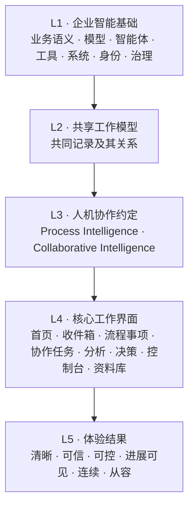
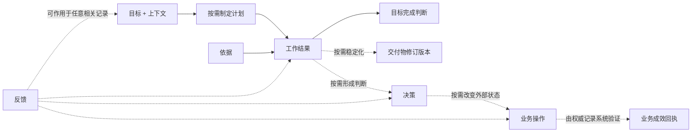

# 企业智能体验原则 2.0

> 人机工作体验架构  
> 核心架构章程 · 修订版本 0.5 · 2026-07-27

| 文档属性 | 内容 |
|---|---|
| 文档角色 | **核心规范**：企业智能体验的唯一架构来源 |
| 状态 | 用于共识和参考体验的工作标准 |
| 主要读者 | 产品、界面与用户体验、人工智能、工程、数据、流程、安全、治理和概念验证交付团队 |
| 战略输入 | Agentic AI 2027 工作说明书 Rev1.0 |
| 适用范围 | Process Intelligence、Collaborative Intelligence及二者之间的受控转换 |
| 非目标 | 单一产品需求文档（PRD）、品牌宣传册、生产组件包、具体技术架构或模型选型 |

## 文档套件与阅读路径

本章程冻结架构、语义边界、治理不变量和验收要求；管理层传播与组件说明分别由体验叙事和核心设计系统承担。

| 文档 | 身份 | 回答的问题 |
|---|---|---|
| 本文件 | 核心规范 | 企业智能由什么构成，哪些边界不可破坏 |
| [体验叙事](./EIX_2.0_EXPERIENCE_NARRATIVE.md) | 配套说明 | 体验价值、用户感受与端到端场景 |
| [EIX 核心设计系统](./EIX_2.0_CORE_DESIGN_SYSTEM.md) | 候选标准 | 通用界面如何通过设计变量、布局基础件和通用组件一致构建 |
| [智能体验设计指导](./EIX_2.0_INTELLIGENCE_UX_GUIDANCE.md) | 候选配套说明 | Process Intelligence 与 Collaborative Intelligence 如何把原则转成工作界面与状态 |
| [Rev 0.5 决策记录](./EIX_2.0_REV_0.5_DECISION_RECORD.md) | 决策记录 | 共享工作模型改造依据，以及工作结果、目标完成判断与业务成效的边界 |
| [静态阅读站点](./index.html) | 交互参考 | 如何检查架构、设计系统、体验设计指导与端到端场景 |

任何配套说明、原型或设计系统不得重新定义共享工作模型、人机协作约定、独立状态字段或治理生命周期。发生冲突时，以本章程为准。

---

## 0. 五分钟结论

### 0.1 一套企业智能体验，两种人机协作约定

- **Process Intelligence**面向有状态、有规则、可编排的结构化工作。系统在明确权限和政策内推进，人处理授权、异常、边界和规则改进。
- **Collaborative Intelligence**面向目标驱动、上下文丰富、路径开放的知识工作。人拥有目标与最终判断，人工智能帮助理解、规划、分析、生成和准备行动。
- 两者共享同一套工作模型、业务概念模型、身份、权限、依据、业务操作、业务成效与反馈语言，并采用不同的人机责任分配。

### 0.2 产品围绕工作对象组织持续工作

对话可以用于表达问题和修改工作，但工作的目标、上下文、工作结果、依据与责任不能只存在于对话记录中。需要复用、协作、发布或审计时，工作结果再被提升为稳定交付物。

```text
目标 + 上下文
      ↓
  按需制定计划
      ↓
有依据支持的工作结果
      ↓
目标完成判断

可选延伸：
交付物 | 决策 → 业务操作 → 业务成效 | 反馈
```

共享工作模型定义共同记录及其关系。一个具体任务只实例化适用的记录和控制，其余明确标记为有条件出现、关联或不适用；页面不会把它渲染成固定流程或进度条。

提示词、对话、表单、拖拽、系统事件和智能体结果用于创建、修改、引用或推进这些记录与工作对象。简单 ChatBI 可以在可信工作结果满足目标后结束；决策、发布、业务操作或业务成效按任务需要出现。

### 0.3 界面与用户体验是人工控制层

业务语义、上下文、管控策略、权限、智能体编排和反馈闭环通常发生在后台。界面与用户体验的战略价值，是把这些隐藏能力转化为用户能够：

- 理解的工作；
- 校准的信任；
- 有效的控制；
- 可恢复的行动；
- 可复用的业务结果。

界面与用户体验是人工控制层，负责把数据语义、流程集成、治理和人工智能能力转成用户可理解、可控制、可恢复的业务操作。

---

## 1. 企业智能体验架构

### 1.1 五层体验架构



| 层级 | 回答的问题 | 典型负责人 | 主要输出 | 明确边界 |
|---|---|---|---|---|
| 企业智能基础 | 人工智能知道什么、能做什么、受什么约束 | 架构、人工智能、数据、流程、安全 | 业务概念与口径、管控策略、智能体、工具与系统能力 | 不定义用户工作方式 |
| 共享工作模型 | 一份工作需要覆盖哪些共同关注点、记录和关系 | 产品、界面与用户体验、平台 | 共同记录、关系与覆盖规则 | 不等同于页面流程或固定步骤 |
| 人机协作约定 | 人与人工智能在不同工作中如何分工 | 产品、界面与用户体验、治理 | 责任、状态、控制与反馈约定 | 不等同于产品或路由 |
| 核心工作界面 | 用户在哪里完成任务 | 产品、界面与用户体验、工程 | 流程事项、协作任务、分析等稳定工作面 | 不重新定义共享工作模型 |
| 体验结果 | 用户是否真正理解并完成工作 | 用户研究、产品、业务负责人 | 清晰、可信、可控等可衡量结果 | 不以视觉偏好代替任务结果 |

### 1.2 共享工作模型

共享工作模型定义企业人工智能任务中可组合的目标、上下文、计划、依据、结果与控制记录。具体场景通过任务投影声明每项是“必需”“有条件出现”“关联”还是“不适用”。



#### 目标与上下文

目标使用业务语言表达希望解决的问题和完成标准，包含负责人、范围和约束，不能等同于提示词或技术任务。

上下文是与当前工作相关且获得授权的信息，包括业务语义、权限、流程状态、数据、文档、规则和历史。上下文必须可查看、移除、纠正和追溯，并区分当前会话、个人、团队与企业边界。

#### 计划

计划用于需要分步推进的复杂任务，记录节点、依赖、状态、风险、缺失输入和停止条件。简单可信回答可以直接交付工作结果。

#### 依据

依据支持事实、计算、结论陈述、决策或建议，必须能够回到数据、文档、规则、事件或执行记录。依据状态不推出权限、人工智能可推进范围或工作状态。

#### 工作结果

工作结果是由特定工作对象修订版本产生的不可变、可引用输出，例如答案、计算、分析、草稿或准备结果。工作结果至少记录：

- `resultId`、产生它的工作对象与修订版本；
- 工作结果类型、范围和创建时间；
- 结论陈述与依据引用；
- 限制和适用边界。

工作结果没有独立的企业生命周期。需要保存、协作、发布或审计时，一个或多个工作结果可以被包装为交付物修订版本。

#### 目标完成判断

目标完成判断是绑定目标修订版本的版本化评估，不是业务成效，也不等同于根对象的工作状态。

```ts
interface GoalResolutionAssessment {
  assessmentId: string
  goalRef: ObjectRevisionRef
  status: "resolved" | "partially-resolved" | "unresolved" | "redirected"
  observation: "criteria-evaluated" | "user-confirmed" | "unobserved"
  resultRefs: ResultRef[]
  evidenceRefs: EvidenceRef[]
  unresolvedItems: string[]
  assessedBy: Principal
  assessedAt: string
}
```

用户获得工作结果后直接离开时，系统可以记录“工作结果已交付”，但不得自动声称目标已解决；界面显示“目标完成情况未观测”。

#### 决策与交付物

决策是由依据与业务判断形成的明确选择，记录选项、备选项、理由、负责人和使用的依据。建议不是决策。

交付物是对一个或多个工作结果的稳定、版本化包装。简单答案不必创建交付物；发布校验仅在产生发布意图和受众时出现。

#### 业务操作与业务成效

业务操作改变外部状态，必须声明执行主体、作用对象、范围、参数、权限、管控策略、风险、可恢复性和执行状态。

业务成效回执只记录真实业务操作或流程事件之后，由权威记录系统观察到的后置结果。它不是分析工作结果，也不是业务操作的工作状态。

#### 反馈

反馈可以作用于目标、上下文、工作结果、决策、业务操作或交互模式，但必须区分：

- 当前工作对象纠正；
- 上下文或长期记忆提案；
- 业务概念模型或规则提案；
- 模型、智能体或交互模式改进信号。

#### 任务投影

| 任务类型 | 必需 | 有条件允许 | 关联 | 不适用 | 合法结束点 |
|---|---|---|---|---|---|
| 可信回答 | 目标、上下文、依据、工作结果、目标完成判断 | 计划 | 反馈 | 交付物、决策、业务操作、业务成效 | 工作结果已交付，目标完成标准已评估；无需创建交付物、决策或业务操作。 |
| 分析交付物 | 目标、上下文、依据、工作结果、目标完成判断、交付物 | 计划 | 反馈 | 决策、业务操作、业务成效 | 交付物修订版本稳定，来源工作结果与依据可追溯；是否发布由独立发布生命周期决定。 |
| 决策支持 | 目标、上下文、依据、工作结果、目标完成判断、决策 | 计划、交付物 | 反馈 | 业务操作、业务成效 | 决策由负责人确认并引用稳定工作结果；建议不得伪装成决策。 |
| 受控业务操作 | 目标、上下文、依据、工作结果、目标完成判断、决策、业务操作 | 计划、交付物 | 业务成效、反馈 | — | 业务操作结束于成功、部分完成或失败；业务成效作为关联记录另行观察。 |
| 流程事项 | 目标、上下文、计划、依据、工作结果、目标完成判断 | 交付物、决策、业务操作 | 业务成效、反馈 | — | 流程事项达到合法终态或进入可见的异常 / 人工接管；规则提案拥有独立生命周期。 |

任务投影只映射共享记录。流程事项还必须按 Process Intelligence 人机协作约定展示事项状态、管控策略、异常与交接等领域字段。

### 1.3 跨记录共享控制机制

以下机制作用于共享工作模型记录和工作对象，并保持各自明确的职责：

| 机制 | 作用 |
|---|---|
| 变更记录 | 描述对工作对象的拟议变更，支持差异、影响预览、确认和审计 |
| 校验 | 对特定对象修订版本执行确定性检查并产生可失效的校验决定 |
| 回执 | 证明依据、决策、批准、执行或成效发生了什么 |
| 修订版本 | 对稳定对象产生不可变版本 |
| 分支 | 隔离探索、追问或模拟，不污染已验证或已发布状态 |
| 交接 | 在类型明确的工作对象之间传递上下文、依据、决策和控制约束 |

不得将“意图 → 变更记录 → 执行 → 校验”之类的交互顺序提升为共享工作模型。

---

## 2. 共享工作对象模型

### 2.1 根工作对象与类型化子对象

一个企业目标使用根工作对象保持身份和连续性；分析、决策、业务操作、流程事项和交付物以类型明确的子对象存在。

```ts
interface EnterpriseWorkRoot {
  rootId: string
  goal: Goal
  owner: Principal
  contextRefs: ContextRef[]
  childRefs: TypedWorkObjectRef[]
  resolutionAssessmentRefs: GoalResolutionAssessmentRef[]
  permissions: PermissionPolicy
  traceId: string
  state: "active" | "paused" | "closed" | "superseded"
}

type TypedWorkObject =
  | MissionObject
  | CaseObject
  | AnalysisObject
  | DecisionObject
  | ActionObject
  | ArtifactObject
  | RuleProposalObject

interface TypedWorkObjectBase {
  id: string
  rootId: string
  type: string
  revision: number
  parentRevision?: ObjectRevisionRef
  owner: Principal
  state: string
  contextSnapshot: ContextSnapshotRef
  evidenceRefs: EvidenceRef[]
  policyVersion: string
  permissionSnapshot: PermissionSnapshotRef
  traceId: string
  createdAt: string
  updatedAt: string
}

interface ResultRecord {
  resultId: string
  producerObjectId: string
  producerRevision: number
  kind: "answer" | "calculation" | "analysis" | "draft" | "prepared-change"
  payloadRef: string
  scope: Scope
  claimRefs: ClaimRef[]
  evidenceRefs: EvidenceRef[]
  limitations: string[]
  createdAt: string
}

interface BusinessOutcomeReceipt {
  outcomeId: string
  sourceActionRef?: ObjectRevisionRef
  sourceCaseRef?: ObjectRevisionRef
  expectedPostcondition: string
  observedPostcondition?: string
  systemOfRecordRef: string
  observationState: "pending" | "observed" | "inconclusive"
  effect: "improved" | "no-change" | "worsened" | "unset"
  observedAt?: string
}
```

`ResultRecord` 是一等核心记录，但不是拥有独立生命周期的类型化子对象。交付物修订版本可以包装一个或多个 `ResultRecord`。`BusinessOutcomeReceipt` 必须关联真实业务操作或流程事件。

### 2.2 修订版本、分支与追踪

- 修订版本是不可变快照；修改已发布对象必须生成新修订版本。
- 分支继承明确的父修订版本，用于追问、模拟和探索。
- 追踪编号用于跨对象关联，不代表这些对象共享同一状态机。
- 分析、流程事项和业务操作不得通过切换页面模式在同一个可变对象上“变身”。
- 简报与完整工作区可以读取同一个分析修订版本，但只改变信息密度，不改变事实。
- 目标完成判断、`ResultRecord` 与 `BusinessOutcomeReceipt` 分别使用稳定编号，并保留对产生它们的目标、工作对象或业务操作修订版本的引用。

### 2.3 稳定编号

ID使用类型化命名空间：

```text
ROOT-018
MIS-041
CASE-204
ANL-118
CLM-118
EVD-118
RSLT-118
DEC-052
ACT-077
OUT-077
GRES-018
RPROP-204
```

结论陈述、依据、工作结果、目标完成判断、业务操作和业务成效不得复用同一个语义前缀。

---

## 3. 三个判断与独立状态字段

界面把相互独立的状态字段组织成用户需要回答的三个问题：

1. 这个结论能信到什么程度；
2. 这件事能不能做、谁来做；
3. 工作现在走到哪一步。

为了避免把“可信”误画成“可执行”，实现层必须分别保存以下事实。任一字段都不得自动推出另一字段。

| 内部字段 | 它回答什么 |
|---|---|
| `ClaimKind` | 这句话属于事实、计算、假设、预测还是建议 |
| `EvidenceStatus` | 依据是否足够、仍有效且未被争议 |
| `Uncertainty` | 是否有经过校准、对决策有用的不确定性表达 |
| `RiskAndReversibility` | 影响有多大，失败后能否撤回或补偿 |
| `PermissionAndPolicy` | 当前主体在当前范围内是否有权限 |
| `Autonomy` | 人工智能当前最多可以建议、准备还是执行 |
| `WorkflowState` | 当前工作对象走到哪一步 |

### 3.1 内容类型 (`ClaimKind`)

| 值 | 含义 | 最低表达要求 |
|---|---|---|
| 事实 | 可直接核实的事实 | 来源、范围、数据截至时间 |
| 计算 | 按确定性方法计算的结果 | 公式或方法、输入资料 |
| 假设 | 待验证的候选解释 | 明确非事实、所需验证 |
| 预测 | 对未来的条件性判断 | 区间、假设、预测范围 |
| 建议 | 建议而非决定 | 理由、备选项、负责人 |

### 3.2 依据状态 (`EvidenceStatus`)

“未验证 → 有依据支持 → 已验证”

旁路状态：“有争议”“已过期”“依据不足”。

依据状态描述依据质量，不描述行动权限。

### 3.3 不确定性 (`Uncertainty`)

只有在完成校准、定义适用对象、样本和决策用途后，才向用户展示置信度或区间。裸小数不得作为可信度、风险和自动执行权限的共同表达。

### 3.4 风险与可恢复性 (`RiskAndReversibility`)

风险至少考虑影响范围、敏感性、外部依赖和失败后果；可恢复性区分：

- 可撤销；
- 可补偿；
- 不可逆。

### 3.5 权限与管控策略 (`PermissionAndPolicy`)

权限决定包含：

- 对象；
- 对象与操作；
- 范围；
- 允许 / 有条件允许 / 不允许；
- 管控策略版本；
- 决定时间与有效期。

### 3.6 人工智能可推进范围 (`Autonomy`)

```text
建议
  → 准备
  → 需要审批
  → 在管控策略范围内执行
  → 仅在异常时介入
```

人工智能可推进范围由权限、管控策略、风险、可恢复性和系统能力共同约束。依据已经验证也不能绕过权限或管控策略。

### 3.7 工作状态 (`WorkflowState`)

工作状态属于特定工作对象生命周期。颜色和文案不得把“依据已验证”“低风险”“允许”“业务操作成功”和“业务成效已观察”合成一个“绿色成功”状态。

---

## 4. 三套受治理生命周期

### 4.1 发布生命周期

```text
草案
  → 已验证
  → 等待审批
  → 已发布
  → 已取代 | 已撤回
```

- 已验证只表示发布检查通过，不代表已经发布。
- 已发布修订版本不可被追问或编辑静默覆盖。
- 依据、范围、管控策略或内容变化会使旧校验决定失效。

### 4.2 业务操作生命周期

```text
已提议
  → 执行前检查就绪
  → 等待审批
  → 已批准
  → 已排队
  → 执行中
  → 成功 | 部分完成 | 失败
```

- 批准不等于执行。
- 执行前必须重新校验对象、权限、管控策略、依据、作用对象状态、有效期和幂等标识。
- 撤销只适用于尚未执行且仍可撤销的操作。
- 已执行操作需要恢复时，创建新的回退或补偿业务操作并引用 `compensatesActionId`；原业务操作终态保持不可变。
- 业务操作成功不自动等于业务成效已观察；`BusinessOutcomeReceipt` 可以稍后到达或保持“等待观察”。

### 4.3 规则变更生命周期

```text
候选
  → 已起草
  → 已验证
  → 已批准
  → 已进入预发布
  → 已启用
  → 已暂停 | 已退役
```

单次人工判断只能产生候选。规则提案至少需要：

- 明确提议人和规则负责人；
- 历史回放和反例测试；
- 冲突与覆盖范围分析；
- 职责分离（SoD）审批；
- 影子运行、预发布或小范围试运行验证；
- 监控、紧急停用开关和回退；
- 仅影响未来符合范围的流程事项。

---

## 5. 两种人机协作约定

### 5.1 Process Intelligence 人机协作约定

> 系统在明确规则、权限和控制范围内推进结构化工作；人在关键决定、异常和边界场景中保持有效控制。

#### 工作特征

- 起点通常是业务事件、任务或状态变化；
- 流程事项具有明确生命周期和负责人；
- 正常路径尽量安静地自动推进；
- 人的注意力优先用于异常、审批、抽检、恢复和边界改进；
- 每次决策、批准、执行和业务成效分别留痕；
- 失败必须支持重试、返工、补偿操作、回退或人工接管。

#### 基础生命周期

```text
业务事件
  → 解释
  → 验证
  → 决定
  → 准备
  → 按需审批
  → 执行
  → 验证业务操作状态
  → 按需观察业务成效
  → 关闭 | 恢复 | 升级处理
  → 记录反馈
```

#### 默认分工

| 阶段 | 系统默认责任 | 人的默认责任 |
|---|---|---|
| 解释 | 识别对象、事件、状态和上下文 | 修正模糊或罕见情况 |
| 验证 | 检查完整性、规则、权限和风险 | 处理管控策略 异常 |
| 决策 | 执行确定性规则或形成候选判断 | 负责边界判断和授权 |
| 准备 | 构造业务操作 预览与执行前检查 | 检查影响和约束 |
| 执行 | 在授权范围内执行并记录 | 不把批准误认为已执行 |
| 验证 | 核实业务操作终态，并在可观测时关联业务成效 | 处理业务偏差 |
| 恢复 | 重试、补偿、重新分派或暂停 | 接管无法自动恢复的流程事项 |
| 改进 | 汇总干预、异常和成效信号 | 确认规则或业务概念模型提案 |

#### 必须可见

流程事项的目标、状态、负责人、队列时长、规则 / 管控策略、必要人工决策、业务操作预览、审批状态、执行状态、业务成效、异常、恢复与审计时间线。

#### 不应该

- 用长对话代替流程事项状态；
- 只展示“自动处理比例”，隐藏未知、失败、SLA和恢复 积压；
- 要求人持续监督正常路径；
- 在无合法管控策略时以低置信度为由继续执行；
- 让审批者重新调查完整上下文；
- 把智能体拟人化为责任主体，掩盖真正负责人。

### 5.2 Collaborative Intelligence 人机协作约定

> 人定义目标、约束和最终判断；人工智能帮助理解上下文、规划工作、生成可验证交付物，并在授权范围内准备或执行行动。

#### 工作特征

- 起点通常是问题、目标、材料或需要完成的交付物；
- 路径可以在工作中逐步形成；
- 多轮交互围绕同一协作任务和交付物积累；
- 人工智能可以推荐下一步，但不能隐藏对目标和上下文的理解；
- 稳定交付物优先于对话记录；
- 洞察可以产生业务操作提案，但不直接改变外部状态。

#### 基础工作形状

Collaborative Intelligence没有一条所有任务都必须走完的生命周期。共同起点是目标与授权上下文，随后按任务深度形成不同投影：

```text
快速回答：
明确目标 → 授权上下文 → 有依据支持的工作结果 → 目标完成判断

分析：
明确目标 → 上下文 → 按需制定计划 → 工作结果 → 验证 → 保存或整理为交付物

决策支持：
工作结果 + 依据 → 决策记录

可选业务操作延伸：
决策 → 业务操作提案 → 受控交接
```

任何路径都可以在目标完成判断处合法结束。发布、决策、业务操作和业务成效只在任务需要时出现。

#### 默认分工

| 阶段 | 人工智能默认责任 | 人的默认责任 |
|---|---|---|
| 明确目标 | 解释目标、识别歧义和缺失输入 | 确认真实目的与边界 |
| 计划 | 推荐路径、工具和交付内容 | 调整优先级与深度 |
| 工作 | 检索、分析、生成、比较和组织 | 提供业务判断和新上下文 |
| 验证 | 绑定依据、暴露限制与冲突 | 判断是否足以回答当前目标或继续决策 |
| 判断目标完成情况 | 准备目标完成判断并说明观测依据 | 确认、继续、重定向或结束 |
| 决策 | 组织选项、取舍和影响 | 作出或授权最终决策 |
| 发布 | 准备交付物修订版本和校验 | 对发布负责 |
| 行动 | 形成业务操作提案与预览 | 授权高影响业务操作 |
| 学习 | 整理可复用上下文和反馈 | 决定持久化边界 |

#### 必须可见

协作任务的目标、完成标准、当前上下文、意图、适用时的计划、工作结果、依据、限制、目标完成判断、可选交付物、分支、修订版本、发布状态和业务操作交接。

#### 不应该

- 把所有工作压缩成聊天记录；
- 在未说明上下文和范围时给出确定性建议；
- 用漂亮分析叙事替代依据；
- 把假设写成事实；
- 在追问时覆盖已验证或已发布修订版本；
- 以置信度直接推导行动权限。

---

## 6. 受控跨约定交接

### 6.1 Collaborative Intelligence → Process Intelligence

```text
已验证依据
  → 由人负责的决策
  → 业务操作提案
  → 权限 / 管控策略 / 风险执行前检查
  → 类型明确的流程事项或业务操作对象
  → 按需审批
  → 执行
  → 业务操作回执
  → 条件具备时记录业务成效回执
```

### 6.2 Process Intelligence → Collaborative Intelligence

```text
流程异常
  → 调查任务
  → 已授权的上下文快照
  → 协作分析
  → 决策记录
  → 恢复流程 | 返工 | 关闭流程事项
```

### 6.3 交接信息包

```ts
interface HandoffEnvelope {
  handoffId: string
  rootId: string
  from: ObjectRevisionRef
  toType: "case" | "mission" | "analysis" | "action"
  goal: GoalRef
  scope: Scope
  contextSnapshot: ContextSnapshotRef
  evidenceRefs: EvidenceRef[]
  decisionOwner: Principal
  permissionSnapshot: PermissionSnapshotRef
  policyVersion: string
  actionConstraints?: ActionConstraints
  requestedDecision?: string
  traceId: string
}
```

交接创建关联对象，不允许一个文档或流程事项在客户端静默更换语义类型。

---

## 7. Collaborative Intelligence 任务类型

### 7.1 五类知识工作

| 类型 | 核心问题 | 典型交付物 |
|---|---|---|
| 知识与研究 | 我们知道什么，依据与冲突是什么 | 带来源的回答、研究看板、依据关系图 |
| 分析 | 发生了什么、为什么、接下来可能怎样 | 已验证回答、分析文档、场景画布 |
| 决策 | 面对选项应如何形成可解释选择 | 决策画布、选项矩阵、决策记录 |
| 创作与沟通 | 如何形成可协作、可发布的业务产出 | 文档、演示文稿、消息、结构化输出 |
| 规划与行动 | 如何把目标变成计划并安全推进 | 执行计划、规划看板、业务操作队列 |

人工智能自助分析属于分析类智能协作，不能代表全部Collaborative Intelligence。

### 7.2 分析类智能协作五维坐标

分析体验通过五个独立维度组合具体场景：

| 维度 | 候选值 |
|---|---|
| 工作问题 | 快速回答、探索、对比、监控、诊断、调查、预测、模拟、决策 |
| 发起方式 | 用户发起、定时发起、事件触发、委托目标 |
| 协作方式 | 直接操作、引导完成、共同创作、委托执行 |
| 界面承载形式 / 交付物 | 回答、工作区、看板、画布、简报、信息流 |
| 业务操作权限 | 读取、建议、准备、需要审批、在管控策略范围内执行 |

例如“CFO 晨间简报”可以组合为`监控 × 定时发起 × 引导完成 × 简报 × 建议`；“委派式利润诊断”可以组合为`诊断 × 委托目标 × 委托执行 × 分析文档 × 准备`。

---

## 8. 人机协作设计原则

每条原则使用同一结构：用户焦虑、机制、体验承诺与设计检查。

### 原则 01 — 工作对象承载持续工作

- **用户焦虑：** 我必须翻聊天记录才能知道现在做到哪里。
- **机制：** 先定义目标、负责人、状态和范围，让工作结果可引用；需要复用或治理时再形成交付物。对话作为输入与变更通道。
- **体验承诺：** 我不读对话记录也能继续工作。
- **设计检查：** 用户能否在十秒内说出当前工作对象、目标、状态和输出？

### 原则 02 — 上下文统一且范围明确

- **用户焦虑：** 我不知道人工智能用了什么信息，也不知道信息会不会被长期记住。
- **机制：** 上下文检查面板显示来源、更新时间、权限、长期记忆边界，以及“移除”和“更正”控制。
- **体验承诺：** 我知道人工智能正在依据什么，并能纠正它。
- **设计检查：** 用户能否区分当前会话、个人、团队和企业上下文？

### 原则 03 — 意图和状态必须可见

- **用户焦虑：** 人工智能可能理解错了，但直到结果出来我才发现。
- **机制：** 目标完成判断、意图摘要、变更差异和稳定状态常驻可见。
- **体验承诺：** 系统不会背着我改变问题。
- **设计检查：** 范围或方法变化是否明确显示影响并重新验证？

### 原则 04 — 人工智能可推进范围逐级开放

- **用户焦虑：** 人工智能会不会把“建议”直接变成“执行”。
- **机制：** 建议、准备、批准和执行分级，并由权限、管控策略、风险和可恢复性共同约束。
- **体验承诺：** 自主权增长可见、可解释、可停止。
- **设计检查：** 高置信度但不允许的业务操作是否仍被阻断？

### 原则 05 — 表达强度服从依据

- **用户焦虑：** 一个写得漂亮的结论可能没有可靠依据。
- **机制：** 结论陈述绑定类型明确的依据回执；分析叙事中的数字引用同一工作结果对象。
- **体验承诺：** 我能从结论回到来源、方法和限制。
- **设计检查：** 已过期、依据不足或有争议的依据，是否会阻止系统将结论标记为“已验证”？

### 原则 06 — 人工干预必须被明确设计

- **用户焦虑：** 系统失败后，我必须从头调查。
- **机制：** 交接携带上下文信息包、已完成工作、依据、失败原因和待决问题。
- **体验承诺：** 接管沿用已有目标、上下文、依据与工作进度。
- **设计检查：** 人工接管是否保留已完成且已验证的工作？

### 原则 07 — 执行前预览后果

- **用户焦虑：** 我不知道点击按钮究竟会改变什么。
- **机制：** 业务操作预览显示执行主体、作用对象、参数、影响、权限、风险和可恢复性。
- **体验承诺：** 改变现实之前，我先看见后果。
- **设计检查：** 用户能否区分准备、批准、队列和执行？

### 原则 08 — 默认支持恢复

- **用户焦虑：** 一次错误操作可能无法恢复。
- **机制：** 为业务操作定义撤销、回退、补偿操作或人工接管，并显示有效窗口。
- **体验承诺：** 出错后仍然有路可走。
- **设计检查：** 不可逆业务操作是否具有额外校验和负责人确认？

### 原则 09 — 保留已验证状态

- **用户焦虑：** 新追问或高级分析失败会破坏已经确认的内容。
- **机制：** 已验证或已发布的修订版本不可变；追问创建分支，高阶分析失败只标记为部分完成。
- **体验承诺：** 探索不会污染正式结论。
- **设计检查：** 归因分析失败时，基础指标是否仍保持已验证状态？

### 原则 10 — 用稳定交付物承接协作

- **用户焦虑：** 一段回答无法被复用、协作和审计。
- **机制：** 工作结果先绑定产生它的对象修订版本、依据和范围；当复用、协作、发布或审计有需要时，再整理为具有负责人、版本和修订记录的交付物。
- **体验承诺：** 重要工作成果能脱离对话独立存在，简单回答不会被迫进入发布流程。
- **设计检查：** 工作结果是否可引用；需要治理时，交付物是否可以被发布、比较、分支和继续编辑？

### 原则 11 — 信息密度适配角色，事实保持一致

- **用户焦虑：** 简化页面可能隐藏风险，不同角色可能看到不同事实。
- **机制：** 快速阅读与完整规范读取同一修订版本，只改变信息密度。
- **体验承诺：** 我看到适合我的深度，但事实不变。
- **设计检查：** 快速阅读是否仍保留范围、更新时间、风险和限制？

### 原则 12 — 失败后仍要保留方向

- **用户焦虑：** “发生错误”没有告诉我还能相信什么、下一步做什么。
- **机制：** 降级说明固定回答：哪里失败、为什么、什么仍有效、缺什么、下一步。
- **体验承诺：** 失败不会让我失去方向。
- **设计检查：** 部分完成状态是否明确保留已验证部分并提供可执行下一步？

### 原则 13 — 视觉语言必须承载语义

- **用户焦虑：** 所有状态都用红黄绿，导致“可信”“允许”和“成功”混为一谈。
- **机制：** 结论陈述、依据、风险、权限、人工智能可推进范围和工作状态使用独立标签、文字、符号与结构。
- **体验承诺：** 我不会因为颜色相同而误读治理状态。
- **设计检查：** 去掉颜色后，各类状态是否仍能通过名称和说明区分？

### 原则 14 — 反馈改进过程必须透明

- **用户焦虑：** 我的纠正可能被系统永久学习，或一次判断直接变成规则。
- **机制：** 区分单次纠正、长期记忆提案、规则提案和模型反馈，并显示负责人与审批路径。
- **体验承诺：** 我知道反馈去了哪里、将改变什么。
- **设计检查：** 单次人工判断是否只能产生候选而不能直接已启用？

---

## 9. 核心体验交互模式

本章程只冻结交互模式目录和不变量；领域结构、状态、变体和交互示例见[智能体验设计指导](./EIX_2.0_INTELLIGENCE_UX_GUIDANCE.md)。通用视觉与组件约定见[EIX 核心设计系统](./EIX_2.0_CORE_DESIGN_SYSTEM.md)。

### 9.1 共享交互模式

- 目标与上下文页头
- 工作结果 & 目标完成判断
- 意图与变更预览
- 计划与进展
- 依据回执
- 决策记录
- 发布校验
- 业务操作预览与授权
- 业务成效回执
- 分支与修订版本
- 人工交接
- 反馈记录
- 降级说明与部分完成结果
- 能力与范围回执

### 9.2 Process Intelligence 交互模式

- 工作队列
- 流程事项工作区
- 决策检查点
- 审批简报
- 异常优先工作台
- 规则提案与变更审批
- 恢复与回退
- 流程控制台
- 执行审计时间线

### 9.3 Collaborative Intelligence 交互模式

- 协作任务工作区
- 研究看板
- 分析文档
- 决策画布
- 创作工作区
- 规划看板
- 受众简报
- 交付物修订记录与分支
- 个人与团队长期记忆库

### 9.4 交互模式不变量

每个交互模式必须声明：

- 用户 目标与用户担忧；
- 工作对象、负责人和适用的人机协作约定；
- 固定与可选区域；
- 独立状态字段和生命周期；
- 权限、人工智能可推进范围与校验；
- 失败、降级说明、恢复与人工接管；
- 响应式与无障碍；
- 验收测试。

只有在两个实质不同的产品或人机协作约定中验证出共同结构后，交互模式才能晋升为共享工程组件。

---

## 10. 语义视觉语言

### 10.1 设计变量层级

```text
foundation.*   品牌、字体、空间、表面与基础边框
interaction.*  选择、焦点、变化与可操作性
claim.*        事实、计算、假设、预测、建议
validation.*   未验证、有依据支持、已验证、有争议、已过期、依据不足
risk.*         影响程度与可恢复性
permission.*   允许、有条件允许、禁止
workflow.*     草稿、待处理、已批准、执行中、成功、失败等对象状态
```

不同设计变量命名空间可以复用色相，但组件必须同时显示状态类别、文字、符号和必要的结构差异。

### 10.2 视觉特征

- 精准而非炫技；
- 安静而非冷漠；
- 高密度但有清晰层级；
- 呈现为可核验、可继续操作的工作底稿；
- 视觉变化必须对应真实状态变化；
- 关键数字使用等宽数字；
- 查询、追踪编号和对象编号使用等宽字体。

渐变、圆角、插画或表情符号由品牌、语义、可读性和场景共同决定。装饰必须服从证据、状态与控制的表达。

### 10.3 动效

动效只用于解释变更记录变化、计划推进、内容区块生成、修订版本与分支，以及真实工作状态变化。启用“减少动态效果”后仍须保留全部信息。

### 10.4 响应式能力

- ≥1280：完整多面板、交互模式检查面板和复杂直接操作；
- 768–1279：单主栏，检查面板转抽屉；
- <768：快速阅读、旅程、评论与审批，不提供复杂拖拽；
- 所有阅读密度读取同一工作对象修订版本。

---

## 11. 校验与回执不变量

### 11.1 校验决定

校验必须绑定：

- 校验类型；
- 对象编号与修订版本；
- 依据快照；
- 管控策略与权限版本；
- 执行主体与决策时间；
- 检查项、通过 / 失败 / 不适用；
- 有效期与失效原因。

任何范围、依据、管控策略、权限、作用对象 状态或内容变化都会使旧校验决定失效。提交或执行时必须原子重验。

### 11.2 类型化系统回执

| 回执 | 证明什么 |
|---|---|
| 依据回执 | 来源、语义版本、方法、范围、更新时间、权限裁剪和限制 |
| 目标完成判断 | 目标修订版本、完成标准、工作结果、依据、未解决项和观测方式 |
| 决策记录 | 谁基于什么依据选择了什么 |
| 审批回执 | 谁在何种管控策略与范围下授权 |
| 执行回执 | 请求、执行、目标、参数、时间、状态、部分失败和幂等标识 |
| 业务成效回执 | 权威记录系统中的预期与已观察后置结果、差异、异常和后续状态 |
| 规则变更回执 | 候选、验证、职责分离、版本、预发布、监控与回退 |

视觉框架可以共享，数据结构和生命周期必须按对象类型定义。

### 11.3 能力快照

当界面准备呈现业务操作、工具或智能体控制时，必须先取得版本化的能力快照，至少包含：

- 能力或工具编号、负责人与版本；
- 输入、输出和范围；
- 允许声明的业务操作集合；
- 风险与可恢复性；
- 所需权限、管控策略与审批条件；
- 回执类型、升级处理负责人与暂停状态；
- 记录时间、有效期与失效原因。

能力快照说明执行主体“声明能做什么”，不等于当前主体“已经获准做什么”，也不等于业务操作已经通过执行前检查。业务操作 校验仍需针对当前执行主体、作用对象、参数、管控策略、权限、风险和作用对象 状态原子重验。

能力声明、权限、人工智能可推进范围和工作状态必须分别存储与表达。缺少范围、版本过期、权限漂移或能力已暂停时，界面可以保留业务操作提案，但不得提供可执行控制。

---

## 12. 企业智能体验验收

### 12.1 方向感

- 用户能识别目标、工作对象、状态、负责人和修订版本；
- 用户从当前页面即可解释正在发生什么；
- 跨人机协作约定时知道创建了哪个新对象及其来源。

### 12.2 理解

- 用户能解释意图、计划、主要限制和下一步；
- 能区分内容类型、依据状态、风险、权限、人工智能可推进范围和工作状态；
- 能区分已准备、已批准、已排队、业务操作成功、目标完成判断和业务成效。

### 12.3 可控

- 写入前具有预览、权限、管控策略、影响和可恢复性；
- 暂停、取消、人工接管、回退或补偿操作在适用时可用；
- 校验失效不会静默复用旧批准。

### 12.4 可信度校准

- 结论陈述可回到类型明确的依据；
- 未校准置信度不制造虚假精确感；
- 已过期、依据不足或有争议 依据不会呈现为已验证。

### 12.5 任务结果

- 对简单可信回答，“依据充分且工作结果已交付”可以满足目标，不强制生成决策、交付物或业务操作；
- 目标完成判断记录判断依据；用户离开而无完成信号时显示“未观测”，不推断成功或失败；
- 需要复用、协作、发布或审计时，交付物可保存、共享、比较和分支；
- 只有真实业务操作或流程事件发生之后，才可以从权威记录系统形成业务成效回执。

### 12.6 恢复

- 失败、部分完成和异常说明原因、保留项、缺失项和下一步；
- 高阶能力失败不删除已验证基础工作；
- 人工接管保留上下文和已完成工作。

### 12.7 连续

- 修订记录、分支、修订版本和交接可继续工作；
- 上下文和长期记忆更新边界明确；
- 不同界面承载形式读取同一事实修订版本。

### 12.8 无障碍

- 完整键盘路径；
- 状态不只依赖颜色；
- 动态变化可被辅助技术感知；
- 支持减少动态效果；
- 图表和依据具备等价文本；
- 正文达到WCAG 2.2 AA；
- 触控目标满足最小尺寸要求。

### 12.9 读者与体验评估

以下内容是真实用户验证的通过条件，不是已经测得的测试成绩。静态参考站只展示需要验证的问题、建议方法和通过条件；只有记录样本量、角色、日期和依据后，才可以另行发布研究结果。

| 维度 | 真实用户验证的通过条件 |
|---|---|
| 架构理解 | ≥90%读者能解释共享工作模型如何按任务组合记录与关系 |
| 任务展开 | ≥90%能让简单ChatBI在可信工作结果后合法结束 |
| 工作结果语义 | ≥90%能区分工作结果、交付物、目标完成判断和业务成效 |
| 状态语义理解 | ≥85%能区分依据、风险、权限和人工智能可推进范围 |
| 工作状态理解 | ≥95%能区分已准备、已批准、业务操作成功与业务成效 |
| 交互模式选择 | ≥85%能为给定场景选择适用交互模式 |
| 文档身份 | 100%知道核心规范、配套说明与候选的区别 |
| 运行正确性 | 非法状态迁移、越权业务操作和状态矛盾为0 |

正式业务指标仍需基于真实场景建立基线，不在本章程中虚构投资回报。

### 12.10 体验信号

体验承诺通过行为和结果信号验证；主观口号或单一自动化比例不构成通过依据：

| 体验承诺 | 前置信号 | 成效信号 |
|---|---|---|
| 清晰 | 范围纠正率、重复澄清次数 | 意图误解导致的返工率 |
| 可信 | 依据展开与限制阅读率 | 结论陈述被采用、争议或撤回的比例 |
| 可控 | 校验前预览、暂停与接管行为 | 未授权业务操作与不可恢复错误为0 |
| 进展可见 | 首个有效工作结果时间、部分完成保留率 | 目标完成时间与等待中断率 |
| 连续 | 分支、修订版本与交接延续率 | 重复解释上下文的时间 |
| 从容 | 异常信噪比、无效提醒率 | 人工监督负担与恢复耗时 |

这些信号用于发现体验问题，不能越过业务负责人、风险、权限或成效判断，也不得以单一“自动化率”替代。

---

## 13. 2027 年界面与用户体验工作流建议

建议在工作说明书中建立独立横向工作流：

> 企业智能体验架构与设计

### 13.1 范围

- 维护核心架构章程与共享工作模型；
- 定义两种人机协作约定和受控交接；
- 建立体验叙事与端到端场景；
- 建立核心设计系统与智能体验设计指导；
- 定义人工监督、校验、业务操作和恢复；
- 设计参考原型；
- 建立读者测试、界面与用户体验评估和验收方法；
- 与业务概念模型、人工智能、流程、安全和前端共同交付。

### 13.2 交付内容

1. 核心架构章程；
2. 体验叙事；
3. EIX 核心设计系统；
4. 智能体验设计指导；
5. 端到端体验架构总览图；
6. 跨约定交接规范；
7. 语义视觉语言与设计变量候选规范；
8. 端到端场景与原型集合；
9. 界面与用户体验研究、读者测试与验收套件；
10. 无障碍、人工监督与设计到工程交接标准。

### 13.3 工程化触发条件

只有满足以下条件才建设共享生产组件包：

- 至少两个实质不同的真实消费者；
- 三套生命周期和独立状态字段稳定；
- 共同交互模式中不含领域名称和场景分支；
- 通用组件接口、版本、迁移说明和负责人明确；
- 无障碍和状态测试自动化。

---

## 14. Rev 0.5 已锁定决定

1. 只有一个核心规范共享工作模型；它是覆盖范围与关系模型，不是顺序、向导或进度条。
2. Process Intelligence与Collaborative Intelligence是两种人机协作约定，不是两个孤立产品。
3. 变更记录、校验、回执、修订版本和交接是机制，不是第二共享工作模型。
4. 对话是输入与控制通道，不是默认产品架构。
5. 根工作对象与类型化子对象保持连续性，分析、流程事项和业务操作不共享可变状态机。
6. 发布、业务操作和规则变更使用三套独立生命周期。
7. 结论陈述、依据、不确定性、风险、权限、人工智能可推进范围和工作状态分别记录，不能互相推出。
8. 批准不等于执行；已验证不等于允许或自动。
9. 单次人工判断只能产生规则候选。
10. 校验绑定修订版本、依据、管控策略和权限，并在提交时重验。
11. 人工智能自助分析属于分析类智能协作，不代表全部Collaborative Intelligence。
12. 稳定交付物优先于对话记录。
13. 人工监督、依据、恢复和审计是体验结构。
14. 视觉语言表达语义和控制权，不以风格偏好替代治理。
15. 配套说明和原型不拥有架构主权。
16. 界面与用户体验是2027 工作说明书的独立横向工作流和验收维度。
17. 核心设计系统与智能体验设计指导分层；核心通用组件不拥有业务生命周期。
18. 中性主题与EIX主题共享同一套语义约定，主题不改变业务语义。
19. 能力快照是业务操作执行前检查的输入，不是权限、批准或执行回执。
20. 工作结果、交付物、目标完成判断与业务成效回执使用不同语义和ID。
21. 简单可信回答可以在目标完成判断处结束；决策、发布、业务操作与业务成效是条件性扩展。
22. 业务操作的工作状态不包含成效状态；补偿操作是引用原业务操作的新业务操作。
23. 业务成效回执与人工交接是两个独立交互模式。
24. 核心规范交互模式目录、在线交互示例和验证成熟度必须显式对账；页面能够渲染，不等于人机协作约定已经验证。

---

## 15. 待决问题

以下问题不阻止Rev 0.5成立，但需要负责人和决策时间：

1. 个人、团队和企业长期记忆的权限与可见边界；
2. 人工智能可推进范围由谁配置，是否按角色、场景、风险和区域变化；
3. 根对象与子工作对象采用统一编号服务还是可追溯映射；
4. 哪些反馈可自动进入改进管道，哪些必须由业务概念模型或规则负责人审批；
5. 智能体活动默认显示到任务、步骤还是工具调用层级；
6. 管理层、业务用户、专家和运营人员的默认信息密度；
7. 哪两个真实产品将作为共享交互模式工程化的第二消费者；
8. 哪两个真实产品将触发`@eix/tokens`与`@eix/ui`生产组件包建设。

---

## 附录 A — 工作术语表

| 术语 | 定义 |
|---|---|
| 企业智能体验 | 企业用户理解、控制并与人工智能共同完成工作的整体体验 |
| 人机协作约定 | 人与系统在一种工作模式中的责任、状态、控制和反馈约定 |
| 共享工作模型 | 企业人工智能工作的核心规范覆盖范围与关系模型；具体任务只实例化适用记录 |
| 根工作对象 | 维持目标、负责人、上下文和追踪连续性的根对象 |
| 类型化子对象 | 分析、流程事项、决策、业务操作等具有独立生命周期的对象 |
| 工作结果 | 由特定工作对象修订版本产生、绑定依据与范围的可引用输出 |
| 交付物 | 对一个或多个工作结果进行稳定、版本化和可发布整理的类型化对象 |
| 目标完成判断 | 评估某个目标修订版本是否已完成以及依据什么的版本化记录 |
| 业务成效回执 | 真实业务操作或流程事件发生后，由权威记录系统记录的后置结果 |
| 变更记录 | 对工作对象拟议修改的可预览、可确认、可审计对象 |
| 校验决定 | 针对特定修订版本和治理快照的确定性校验结果 |
| 能力快照 | 版本化记录某个工具或智能体声明的范围、业务操作集合、风险、回执与升级路径；不是授权 |
| 依据回执 | 将结论陈述连接到来源、方法、范围、更新时间和限制的对象 |
| 业务操作预览 | 在改变外部状态前展示执行主体、作用对象、影响、权限和可恢复性 |
| 交接 | 在类型明确的工作对象之间传递授权上下文和控制约束 |
| 分支 | 不覆盖父修订版本的探索或追问分支 |
| 语义视觉语言 | 使用视觉结构区分业务状态和控制权的规则 |

## 附录 B — 核心规范评审清单

- [ ] 文档是否明确核心规范、配套说明与候选身份；
- [ ] 是否只有一个共享工作模型，且没有被表达成固定流程或进度条；
- [ ] 是否允许简单可信回答在目标完成判断处合法结束；
- [ ] 工作结果、交付物、目标完成判断与业务成效是否分开；
- [ ] 工作对象是否类型明确且生命周期独立；
- [ ] 两种人机协作约定责任边界是否清晰；
- [ ] 跨约定交接是否携带完整治理信息包；
- [ ] 关键状态是否独立存储，并在界面上按三个问题清楚组织；
- [ ] 发布、业务操作和规则变更是否使用独立生命周期；
- [ ] 校验是否绑定修订版本并可被变化失效；
- [ ] 批准、业务操作成功与业务成效是否可被用户区分；
- [ ] 原则是否同时包含用户担忧、机制、体验承诺和设计检查；
- [ ] 交互模式是否定义失败、恢复和无障碍；
- [ ] 视觉语言是否表达语义而非人工智能装饰；
- [ ] 验收是否可进入概念验证和工作说明书；
- [ ] 待决问题是否有负责人与决策时点；
- [ ] 是否避免将界面与用户体验缩减为前端交付。
