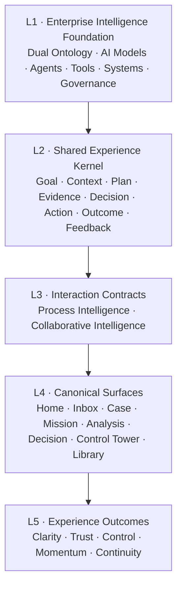

# Enterprise Intelligence Experience Principles 2.0

> Human–AI Work Experience Architecture  
> Concept Charter · Working Draft v0.1

| 文档属性 | 内容 |
|---|---|
| 文档类型 | Experience Architecture & Design Principles Whitepaper — Concept Charter |
| 状态 | Working Draft for Alignment |
| 主要读者 | Product、UX、AI、Engineering、Data、Process、Governance、PoC Delivery Partners |
| 战略输入 | Agentic AI Project 2027 Scope of Work Rev1.0 |
| 适用范围 | Process Intelligence、Collaborative Intelligence及二者之间的受控转换 |
| 非目标 | 具体业务PRD、单一产品UI规范、品牌宣传册、组件级Design System |

---

## 0. Charter目的

本Concept Charter用于确认Enterprise Intelligence 2.0的体验北极星。它先回答四个问题：

1. Process Intelligence与Collaborative Intelligence之间是什么关系；
2. 所有Human–AI工作场景共享什么体验内核；
3. 不同工作模式需要遵守什么Interaction Contract；
4. 如何把可理解、可控、可信、可恢复和持续增强转化为可实施、可验收的UIUX标准。

本文件不是完整白皮书。它冻结核心模型、设计原则、Pattern范围和验收维度，作为后续正式白皮书、参考原型、Design System和SOW UX工作流的共同起点。

---

## 1. Executive Thesis

### 1.1 核心判断

Process Intelligence与Collaborative Intelligence不是两个独立产品，而是同一个Enterprise Intelligence Experience中的两种Interaction Contract。

- **Process Intelligence**处理可建模、有状态、有规则的结构化工作。系统负责推进，人负责授权、判断、处理例外和改善规则。
- **Collaborative Intelligence**处理目标驱动、上下文丰富、路径开放的知识工作。人负责目标与判断，AI负责理解、推理、规划、生成和受控行动。
- 两者共享Data & Business Ontology、Process Ontology、Context、Identity、Permission、Evidence、Action、Feedback和Governance。
- 两者可以相互转换：开放式调查可生成受控流程行动；流程异常可打开协作式调查空间。

### 1.2 产品不以Chat为中心

Chat是输入与控制通道，不是企业智能工作的长期容器。

企业工作需要稳定的工作对象：

```text
Goal
  → Context
  → Plan
  → Evidence
  → Decision
  → Action
  → Outcome
  → Feedback
```

对话、表单、拖拽、数据选择、系统事件和Agent结果都只是在修改或推进这些对象。

### 1.3 UIUX的战略价值

Enterprise AI的大部分关键能力不可直接看见：Ontology、Context、Reasoning、Policy、Confidence、Permission、Agent Orchestration和Feedback Loop都发生在后台。

UIUX的任务不是装饰这些能力，而是让用户：

- 知道系统正在处理什么；
- 理解系统为什么这样判断；
- 看见使用了什么Context和Evidence；
- 在行动前理解影响；
- 在需要时能够干预、暂停、修改和接管；
- 在出错后能够恢复；
- 感受到系统正在减少负担，而不是制造新的监督工作。

因此，UIUX不是SOW的展示层，而是Enterprise Intelligence的Human Control Layer。

---

## 2. Enterprise Intelligence Experience Architecture

### 2.1 五层体验架构



| 层级 | 负责回答 | 典型Owner |
|---|---|---|
| Foundation | AI知道什么、能做什么、受什么约束 | Architecture、AI、Data、Process、Security |
| Experience Kernel | 一份工作由哪些稳定对象构成 | Product、UX、Platform |
| Interaction Contract | 人和AI如何分工 | Product、UX、Governance |
| Canonical Surfaces | 用户在哪里完成任务 | Product、UX、Engineering |
| Experience Outcomes | 用户是否真正理解、控制并完成工作 | UX Research、Product、Business Owner |

### 2.2 Shared Experience Kernel

#### Goal

用户或组织希望实现的业务结果。Goal必须用业务语言表达，不能等同于Prompt。

#### Context

与当前工作相关且获得授权的信息，包括：

- 业务对象与语义；
- 用户、角色和权限；
- 流程状态与历史；
- 数据、文档和知识；
- 规则、政策与控制；
- 已有决定、行动与反馈。

Context必须可查看、可纠正、可追溯来源，并区分临时Context和持久Memory。

#### Plan

为了实现Goal而生成的可检查路径。Plan可以由AI推荐，但其节点状态、依赖、风险和缺失输入必须可见。

#### Evidence

支持事实、计算、判断或建议的可验证依据。Evidence不是“AI引用了一些内容”，而是能够回到数据、文档、规则、事件或执行记录的Receipt。

#### Decision

从Evidence和业务判断形成的明确选择。Decision需要记录：

- 选择了什么；
- 为什么；
- 谁或什么规则作出；
- 使用了哪些Evidence；
- 是否需要审批；
- 如何修改或撤销。

#### Action

改变外部状态的受控操作。所有Action必须声明目标、对象、影响范围、权限、可逆性和执行状态。

#### Outcome

Action或分析产生的实际结果，包括成功、失败、部分成功、异常和未决状态。

#### Feedback

来自用户、业务结果、系统执行和评估机制的信号。Feedback必须区分：

- 对单次工作的修正；
- 对Context或Memory的更新；
- 对规则或Ontology的提案；
- 对模型、Agent或Pattern的改进信号。

### 2.3 Shared Work Object

两种Intelligence使用同一抽象工作对象：

```ts
interface EnterpriseWorkObject {
  id: string
  type: "case" | "mission" | "analysis" | "decision" | "action"
  goal: Goal
  context: ContextPack
  plan: PlanNode[]
  evidence: EvidenceRef[]
  decisions: DecisionRecord[]
  actions: ControlledAction[]
  outcomes: Outcome[]
  feedback: FeedbackSignal[]
  state: WorkState
  owner: Principal
  collaborators: Principal[]
  permissions: PermissionPolicy
  history: Revision[]
}
```

具体产品可以显示不同字段和密度，但不能为不同页面重新创造互不兼容的状态模型。

---

## 3. Two Interaction Contracts

### 3.1 Process Intelligence Contract

#### Contract Statement

> 系统在明确规则、权限和控制范围内推进结构化工作；人在关键决定、异常和边界场景中保持有效控制。

#### 工作特征

- 起点通常是业务事件、任务或状态变化；
- 工作对象具有明确生命周期；
- 正常路径应尽量自动推进；
- 人的注意力优先用于异常、审批和高风险判断；
- 每次决定与行动都必须可审计；
- 失败必须支持重试、返工、补偿、回滚或人工接管。

#### 基础生命周期

```text
Event
  → Interpret
  → Validate
  → Decide
  → Approve when required
  → Execute
  → Verify outcome
  → Close or handle exception
  → Capture feedback
```

#### 默认Human–AI分工

| 阶段 | 系统默认责任 | 人的默认责任 |
|---|---|---|
| Interpret | 识别对象、事件、状态和上下文 | 修正罕见或模糊情况 |
| Validate | 检查规则、权限、完整性和风险 | 处理政策例外 |
| Decide | 执行确定性规则或生成候选判断 | 审批高风险或低置信度判断 |
| Execute | 调用受控工具和系统API | 授权敏感行动 |
| Recover | 重试、补偿、路由异常 | 接管无法自动恢复的Case |
| Improve | 收集执行和干预信号 | 确认规则或Ontology更新 |

#### 必须可见的体验结构

- Case Identity与业务Goal；
- 当前State、已完成State和下一State；
- AI判断、业务规则与置信度；
- Required Human Decision；
- Action Preview与影响范围；
- Execution Receipt；
- Exception、Recovery和Takeover；
- Full Timeline与Audit Trail。

#### Process Intelligence不应该

- 用长对话代替Case状态；
- 要求用户持续监督正常路径；
- 在低置信度时静默推进；
- 把系统错误伪装成业务异常；
- 只给出失败信息，不给恢复路径；
- 让审批者重新阅读完整上下文才能做决定。

---

### 3.2 Collaborative Intelligence Contract

#### Contract Statement

> 人定义目标、约束和最终判断；AI帮助理解上下文、规划工作、生成可验证产出，并在授权范围内执行行动。

#### 工作特征

- 起点通常是问题、目标、材料或需要完成的产出；
- 路径可以在工作中逐步形成；
- 多轮交互围绕同一Mission和Artifact持续积累；
- AI可以推荐下一步，但不能隐藏其对Goal和Context的理解；
- 稳定产出优先于对话记录；
- Insight可以连接受控Action，并在必要时进入Process Intelligence。

#### 基础生命周期

```text
Frame Goal
  → Assemble Context
  → Propose Plan
  → Explore / Create / Analyze
  → Validate Evidence
  → Form Decision or Artifact
  → Act when authorized
  → Review outcome
  → Save, reuse and learn
```

#### 默认Human–AI分工

| 阶段 | AI默认责任 | 人的默认责任 |
|---|---|---|
| Frame | 解释目标、识别歧义和缺失信息 | 确认真实目的和边界 |
| Plan | 推荐路径、工具和可交付物 | 调整优先级与深度 |
| Work | 检索、分析、生成、比较和组织 | 提供业务判断与新Context |
| Validate | 绑定Evidence、暴露限制和冲突 | 判断是否足以决策 |
| Decide | 组织选项、Trade-off和影响 | 作出或授权最终决定 |
| Act | 预览并执行获得授权的工具操作 | 确认高影响行动 |
| Learn | 整理可复用Context和反馈 | 决定什么可以持久化 |

#### 必须可见的体验结构

- Mission Goal与Success Definition；
- Active Context与Memory边界；
- AI对Intent的理解；
- Work Plan与进度；
- Artifact、Analysis或Decision的稳定画布；
- Evidence、Confidence和Limitation；
- Next Best Action；
- Branch、Revision和Collaboration；
- Tool Action Preview与Result。

#### Collaborative Intelligence不应该

- 把所有工作压缩到一个聊天线程；
- 让用户通过翻阅历史消息理解当前状态；
- 在未说明Context的情况下给出确定性建议；
- 将漂亮叙事替代Evidence；
- 自动把Hypothesis写成Fact；
- 在用户追问时破坏已验证Artifact。

---

### 3.3 Contract之间的受控转换

#### Collaborative → Process

当Insight或Decision需要改变外部状态时：

```text
Verified Evidence
  → Decision
  → Action Proposal
  → Permission and Policy Check
  → Process Case
  → Execution
  → Outcome Receipt
```

转换时必须携带Goal、Scope、Evidence、Decision Owner和Action Constraints。

#### Process → Collaborative

当流程出现非标准、复杂或需要开放判断的异常时：

```text
Process Exception
  → Investigation Mission
  → Context Pack
  → Collaborative Analysis
  → Recommended Decision
  → Human Approval
  → Resume / Rework / Close Case
```

转换不能复制一份脱离原Case的聊天上下文；调查结果必须回写原Case的Decision和Evidence。

---

## 4. Collaborative Intelligence Experience Families

Collaborative Intelligence不是Chatbot 2.0的单一形态，而是一组共享Kernel的知识工作体验。

### 4.1 Knowledge & Research Intelligence

回答“我们知道什么、依据是什么、不同来源如何冲突”。

典型任务：

- 企业知识问答；
- 跨文档研究与综合；
- 政策、合同和标准解释；
- 事实核实与来源比较；
- 专题Research Brief。

主要Artifact：

- Answer with Sources；
- Research Board；
- Evidence Map；
- Synthesized Brief。

### 4.2 Analytical Intelligence

回答“发生了什么、为什么、接下来可能怎样”。

| 分析形态 | 核心问题 | 默认Artifact |
|---|---|---|
| Rapid Answer | `[Metric / Fact]是什么？` | Verified Answer |
| Explore | `数据中有哪些值得关注的结构？` | Analysis Workspace |
| Compare | `对象、期间或版本之间有什么差异？` | Comparative Analysis |
| Monitor | `什么发生了变化或需要注意？` | Signal Feed / Brief |
| Diagnose | `变化可能由什么驱动？` | Diagnostic Story |
| Investigate | `现有证据能支持或排除什么？` | Evidence Board |
| Forecast | `未来最可能怎样，区间是什么？` | Forecast Brief |
| Simulate | `如果条件改变，会发生什么？` | Scenario Canvas |
| Decide | `基于分析应选择什么？` | Decision Brief |

AI自助分析属于Analytical Intelligence，但不能代表全部Collaborative Intelligence。

### 4.3 Decision Intelligence

回答“面对多个选项，我们应该如何选择”。

典型能力：

- Decision Frame；
- Options与Trade-off；
- Assumption Register；
- Impact与Risk；
- Scenario Comparison；
- Decision Record；
- Approval与Action Handoff。

默认Artifact是Decision Canvas，而不是聊天答案。

### 4.4 Creation & Communication Intelligence

回答“如何形成高质量、符合语境的业务产出”。

典型任务：

- 起草和改写；
- Review与Redline；
- 汇报材料；
- 邮件、方案、纪要与说明；
- 从Analysis或Decision生成Audience-specific Narrative。

默认Artifact是可版本化的Document、Deck、Message或Structured Output。

### 4.5 Planning & Action Intelligence

回答“如何把目标变成可执行计划，并安全推进”。

典型能力：

- Goal Decomposition；
- Multi-step Plan；
- Owner、Dependency和Due State；
- Agent / Tool Assignment；
- Action Preview；
- Execution Tracking；
- Human Handoff。

当计划进入稳定、重复和可建模执行后，应逐步转换为Process Intelligence。

---

## 5. Human–AI Design Principles

### Principle 01 — Work Object before Chat

所有体验首先定义用户正在处理的业务对象，而不是先放置输入框。

**Design Test**

- 用户能否不阅读聊天记录就理解当前工作？
- 页面是否明确Goal、Owner、State和Output？

### Principle 02 — One Context, Explicitly Scoped

Context必须跨分析、决策和行动保持连续，同时明确哪些信息正在被使用。

**Design Test**

- 用户能否查看、移除或纠正Context？
- 系统是否区分当前Context、Persistent Memory和External Source？

### Principle 03 — Intent and State Must Be Visible

系统必须把“我理解你要做什么”和“工作现在在哪里”变成稳定界面。

**Design Test**

- 用户是否能识别系统对Goal的解释？
- 当前State和下一步是否无需询问AI即可看见？

### Principle 04 — Autonomy Must Be Progressive

自主权不是开或关，而是随风险、可逆性、置信度和授权逐级提升。

```text
Explain
  → Recommend
  → Prepare
  → Execute with approval
  → Execute within policy
  → Monitor by exception
```

**Design Test**

- 用户是否知道AI当前处于哪一级自主权？
- 高影响Action是否自动降低自主级别？

### Principle 05 — Evidence before Eloquence

任何重要结论、建议和决定都必须先具备Evidence，再组织Narrative。

**Design Test**

- 用户能否从Claim回到原始Evidence？
- Fact、Calculation、Hypothesis和Forecast是否视觉可区分？

### Principle 06 — Human Intervention Is a Designed Path

人工介入不是系统失败，而是Agentic Work的正常组成。

**Design Test**

- 人是否获得足够Context，而不是从头调查？
- 接管后能否继续使用已完成的系统工作？

### Principle 07 — Preview Consequence before Action

任何改变外部状态的操作，都应在执行前展示对象、范围、影响、权限和可逆性。

**Design Test**

- 按钮是否准确描述将发生什么？
- 用户是否能区分读取、生成、建议和真实写入？

### Principle 08 — Reversible by Default

可撤销、可回滚、可补偿或可恢复必须成为Action设计的一部分。

**Design Test**

- 出错后是否存在明确Recovery Path？
- 不可逆操作是否获得额外确认和解释？

### Principle 09 — Preserve Verified State

探索、失败和新分支不能破坏已验证结果或已发布内容。

**Design Test**

- 高阶分析失败时，基础Evidence是否仍然保留？
- 追问是否创建Branch或Revision，而不是静默覆盖？

### Principle 10 — Stable Artifacts over Transcripts

企业成果必须形成可保存、可复用、可协作和可审计的Artifact。

**Design Test**

- 结果是否可以脱离对话独立阅读？
- 是否有Owner、Revision、Status、Evidence和History？

### Principle 11 — Role-adaptive Density, Shared Truth

不同角色可以获得不同信息密度，但不能拥有不同事实版本。

**Design Test**

- 管理层、业务用户和专家是否读取同一Work Object？
- 简化视图是否隐藏了关键Limitations或风险？

### Principle 12 — Failure Must Preserve Orientation

失败状态要告诉用户：哪里失败、为什么、什么仍然有效、接下来能做什么。

**Design Test**

- 是否避免使用无方向的“发生错误”？
- Partial Success是否被正确保留和表达？

### Principle 13 — Visual Language Carries Semantics

颜色、排版、图形、空间和动效必须表达真实业务语义，而不是装饰AI感。

**Design Test**

- 去掉文案后，用户是否仍能区分Fact、Risk、Action和Exception？
- 同一语义在不同产品中是否保持一致？

### Principle 14 — Feedback Must Improve the System Transparently

系统可以从反馈中改进，但用户必须知道什么被记录、什么会改变，以及由谁确认。

**Design Test**

- Feedback是否区分单次修正和长期学习？
- Ontology、Rule或Memory的更新是否经过Owner治理？

---

## 6. Canonical Experience Patterns

### 6.1 Shared Patterns

| Pattern | 目的 | 固定内容 |
|---|---|---|
| Goal & Scope Header | 保持方向感 | Goal、Owner、State、Scope、Freshness |
| Context Inspector | 解释AI正在使用什么 | Source、Permission、Memory、Remove/Correct |
| Plan & Progress | 展示工作路径 | Node、Status、Dependency、Missing Input |
| Evidence Receipt | 建立可追溯性 | Source、Calculation、Scope、Confidence、Limit |
| Decision Record | 记录判断 | Option、Rationale、Evidence、Owner、Approval |
| Action Preview | 防止误操作 | Target、Impact、Permission、Reversibility |
| Outcome Receipt | 证明发生了什么 | Execution Result、Time、Exception、Next State |
| Branch & Revision | 保护已验证内容 | Parent、Diff、Owner、Status、Merge Policy |
| Human Handoff | 让接管可继续 | Reason、Context Pack、Work Done、Requested Decision |
| Feedback Capture | 形成治理闭环 | Signal Type、Scope、Destination、Owner |

### 6.2 Process Intelligence Patterns

- Work Queue；
- Case Workspace；
- Decision Checkpoint；
- Approval Brief；
- Exception Center；
- Recovery & Rollback；
- Process Control Tower；
- Execution Audit Timeline。

### 6.3 Collaborative Intelligence Patterns

- Mission Workspace；
- Research Board；
- Analysis Document；
- Decision Canvas；
- Creation Workspace；
- Planning Board；
- Audience Brief；
- Personal / Team Memory Library。

### 6.4 Pattern Specification Template

每个Pattern必须使用统一模板：

```yaml
pattern:
  name: "[Pattern Name]"
  interaction_contract: "process | collaborative | shared"
  user_goal: "[User Goal]"
  work_object: "[Case / Mission / Analysis / Decision / Action]"
  trigger: "[When it appears]"
  fixed_regions:
    - "[Required region]"
  optional_regions:
    - "[Conditional region]"
  supported_actions:
    - "[Action]"
  autonomy_policy:
    default_level: "[Level]"
    escalation_rule: "[Rule]"
  evidence_policy: "[Evidence requirement]"
  permission_policy: "[Permission rule]"
  failure_states:
    - "[Failure and recovery]"
  feedback_signals:
    - "[Captured signal]"
  accessibility_requirements:
    - "[Requirement]"
  acceptance_tests:
    - "[Test]"
```

---

## 7. Visual Experience Principles

### 7.1 Desired Experience Qualities

| Experience Quality | 用户感受 | 视觉与交互机制 |
|---|---|---|
| Clarity | 我知道正在处理什么 | Goal Header、State、Scope、Stable Layout |
| Trust | 我知道依据和限制 | Evidence、Provenance、Confidence、Limitation |
| Control | 我知道能在哪里干预 | Preview、Approval、Pause、Edit、Undo |
| Momentum | 我看到工作在推进 | Plan、Progress、Partial Result、Next Step |
| Continuity | 我不需要每次重新开始 | Context、Memory、History、Artifact、Handoff |
| Mastery | 系统放大了我的能力 | Recommended Path、Comparison、Explanation |
| Calm | 自动化没有制造新的焦虑 | Exception-first、Priority、Quiet Default States |

### 7.2 Semantic Visual Vocabulary

视觉系统至少要区分：

| Semantic Type | 含义 | 表达要求 |
|---|---|---|
| Fact | 可直接验证的事实 | 稳定、明确、绑定Source |
| Calculation | 基于确定性逻辑得出的结果 | 展示Formula或Method |
| Hypothesis | 候选解释 | 不使用确定性语气 |
| Forecast | 带不确定性的未来判断 | 必须展示区间和条件 |
| Recommendation | 建议而非决定 | 展示Rationale与Alternative |
| Decision | 已确认选择 | 展示Owner、Time和Evidence |
| Action | 将改变外部状态 | 展示Impact和Permission |
| Exception | 偏离预期路径 | 展示Severity和Recovery |
| Restriction | 权限或政策限制 | 解释为什么不可执行 |

语义不能只依赖红绿颜色；必须同时使用文字、图形、结构或符号。

### 7.3 Visual Character

Enterprise Intelligence 2.0的视觉应体现：

- 精准而非炫技；
- 安静而非冷漠；
- 高信息密度但不拥挤；
- 明确的状态层级；
- 可信的Evidence表达；
- 对高风险Action保持克制；
- 在复杂工作中提供方向感。

不以全屏渐变、玻璃拟态、霓虹、机器人形象、漂浮AI球、无意义动画或Chat气泡墙表达“智能”。

### 7.4 Motion

动效只用于解释：

- State发生变化；
- Context或Intent被修改；
- Plan Node开始或完成；
- Artifact被提升为Verified；
- Action由Prepared进入Executed；
- Work Object转换为Branch或新的Contract。

动效不能掩盖等待时间、制造虚假进度或替代状态文本。

---

## 8. Enterprise Intelligence UX Acceptance

现有技术验收需要增加Experience Gate。

### 8.1 Orientation

- 用户能够识别当前Goal、Work Object、State和Owner；
- 用户无需阅读完整History即可说明当前发生了什么；
- Process与Collaborative模式转换时保持Context连续。

### 8.2 Comprehension

- 用户能够正确解释AI的Intent、Plan和主要限制；
- 用户能够区分Fact、Hypothesis、Forecast、Decision和Action；
- 关键业务术语与Ontology定义一致。

### 8.3 Control

- 用户知道哪些步骤由AI执行、哪些需要人工判断；
- 写入操作具有Preview、Permission和明确确认；
- Pause、Cancel、Undo、Rollback或Takeover在适用时可用。

### 8.4 Trust Calibration

- 用户能够找到关键Claim的Evidence；
- Confidence表达不会制造虚假精确感；
- 低质量或不完整Evidence不能被视觉包装成Verified Result。

### 8.5 Task Outcome

- 用户能够完成目标任务，而不是只获得一段回答；
- Artifact能够被保存、共享、复用和审计；
- 正常路径减少操作，例外路径减少重新调查。

### 8.6 Recovery

- Failure、Partial和Exception状态具有明确恢复动作；
- 高阶能力失败不会删除已验证基础工作；
- 人工接管保留已完成的系统工作和Context。

### 8.7 Continuity

- 用户可以从History、Branch或Handoff继续工作；
- Context和Memory更新具有明确边界；
- 同一事实不会因不同Surface产生多个版本。

### 8.8 Accessibility

- 完整键盘操作；
- 状态不只依赖颜色；
- 动态变化可被辅助技术感知；
- 支持Reduced Motion；
- 图表和Evidence具备等价文本；
- 不因角色简化而隐藏关键风险信息。

### 8.9 Evaluation Framework

正式目标值需要基于基线研究确定，不在Concept Charter中虚构。

| 维度 | 候选指标 |
|---|---|
| Effectiveness | Task Completion、Decision Accuracy、Exception Resolution |
| Efficiency | Time to Goal、Human Touch Time、Rework、Context Re-entry |
| Comprehension | State、Evidence、Action Consequence理解正确率 |
| Control | Intervention Success、Recovery Success、Unauthorized Action Prevention |
| Trust Calibration | Confidence与实际质量匹配、Over-trust / Under-trust |
| Adoption | Repeat Use、Artifact Reuse、Pattern Reuse、Voluntary Retention |
| Accessibility | Keyboard Completion、Assistive Technology Completion |
| Operational Quality | Audit Completeness、Feedback Capture、Critical UX Defects |

---

## 9. Proposed UX Workstream for the 2027 Program

建议在SOW中增加横向工作流：

> Enterprise Intelligence Experience Architecture & Design

### 9.1 Scope

- 定义Shared Experience Kernel；
- 定义Process与Collaborative Interaction Contracts；
- 建立Canonical Experience Pattern Library；
- 建立Semantic Visual Language；
- 建立Human Oversight、Action和Recovery标准；
- 设计Reference Prototypes；
- 建立UX Evaluation与Acceptance方法；
- 与Ontology、AI、Process、Security和Front-end团队共同交付。

### 9.2 Deliverables

1. Enterprise Intelligence Experience Principles 2.0 Whitepaper；
2. End-to-end Experience Architecture Map；
3. Process Intelligence Pattern Library；
4. Collaborative Intelligence Pattern Library；
5. Cross-contract Handoff Specification；
6. Semantic Visual Language与Design Tokens；
7. Reference Prototype Set；
8. UX Research、Evaluation与Acceptance Kit；
9. Accessibility与Human Oversight Checklist；
10. Design-to-Engineering Handover Standards。

### 9.3 Required Roles

- Experience / Product Design Lead；
- Service Designer；
- Product Designer；
- UX Researcher；
- UX Engineer / Design Technologist；
- Content Designer；
- Accessibility Specialist；
- Design System Engineer。

部分角色可以由同一人员承担，但这些责任不能只归入Front-end Development。

---

## 10. Full Whitepaper Proposed Structure

### Part I — Strategy

1. Why Enterprise Intelligence Needs an Experience Architecture  
2. Human–AI Work Model  
3. Two Interaction Contracts, One Enterprise Experience  
4. Experience Outcomes and Business Value  

### Part II — Shared Experience Kernel

5. Work Objects  
6. Goal and Intent  
7. Context and Memory  
8. Plan and Progress  
9. Evidence and Trust  
10. Decision and Action  
11. Outcome and Feedback  
12. Identity, Permission and Governance  

### Part III — Process Intelligence

13. Process Interaction Contract  
14. Case and State Model  
15. Human Oversight  
16. Exception, Recovery and Takeover  
17. Process Control Tower  
18. Process Intelligence Pattern Library  

### Part IV — Collaborative Intelligence

19. Collaborative Interaction Contract  
20. Knowledge & Research  
21. Analytical Intelligence  
22. Decision Intelligence  
23. Creation & Communication  
24. Planning & Action  
25. Collaborative Intelligence Pattern Library  

### Part V — Cross-contract Experience

26. Insight to Controlled Action  
27. Exception to Collaborative Investigation  
28. Handoff, Branch and Revision  
29. Personal, Team and Enterprise Memory  

### Part VI — Visual & Interaction System

30. Semantic Visual Language  
31. Information Density and Role Adaptation  
32. Motion and State Change  
33. Failure and Empty States  
34. Accessibility  
35. Enterprise Design System Integration  

### Part VII — Delivery & Evaluation

36. Reference Architecture to Reference Experience  
37. UX Workstream and Operating Model  
38. Evaluation Framework  
39. Acceptance Criteria  
40. PoC Selection and Maturity Roadmap  

### Appendices

- Pattern Specification Template；
- Work Object Schema；
- Autonomy Classification；
- Evidence and Action Receipt；
- UX Review Checklist；
- Glossary。

---

## 11. Decisions Locked by This Charter

1. Process Intelligence和Collaborative Intelligence是两种Interaction Contract，不是两套独立产品。
2. 两者共享Experience Kernel、Ontology、Context、Governance和Feedback。
3. Chat是输入方式，不是默认产品架构。
4. Stable Work Object和Artifact是企业智能体验的核心载体。
5. AI自助分析是Collaborative Intelligence的一部分，不代表全部形态。
6. Human Oversight、Action Preview、Evidence、Recovery和Audit是体验结构，不只是后台能力。
7. Visual Design必须表达语义、状态、风险和控制权。
8. UIUX需要成为2027 SOW的独立横向工作流和验收维度。

---

## 12. Open Questions for the Full Whitepaper

以下问题不阻止Concept Charter成立，但需要在完整白皮书中决定：

1. Enterprise Intelligence采用一个统一Shell，还是多个产品共享Kernel与Design System？
2. Personal Memory、Team Memory和Enterprise Context的权限边界如何呈现？
3. Autonomy Level由谁配置，是否允许按用户、场景和风险动态变化？
4. Process和Collaborative Work Object使用统一ID体系还是可追溯映射？
5. 哪些Feedback可以自动进入改进流程，哪些必须由Ontology或Rule Owner审批？
6. AI Agent活动的可见性应达到任务级、步骤级还是工具调用级？
7. 管理层、业务用户、专家和运营人员需要哪些默认信息密度？
8. Reference PoC应选择哪些通用Pattern来覆盖两个Contract和双向转换？

---

## Appendix A — Working Glossary

| Term | Working Definition |
|---|---|
| Enterprise Intelligence Experience | 企业用户理解、控制并协同AI完成工作的整体体验 |
| Interaction Contract | 人与系统在一种工作模式中的责任、状态、控制和反馈约定 |
| Experience Kernel | 所有场景共享的稳定体验对象和行为 |
| Work Object | 可保存、可协作、可审计的工作实体 |
| Process Intelligence | 面向结构化工作解释、决策、编排与执行的智能模式 |
| Collaborative Intelligence | 面向开放式知识工作理解、推理、规划、协作与行动的智能模式 |
| Artifact | 能脱离对话独立使用的稳定产出 |
| Evidence Receipt | 将Claim或Decision连接到来源、计算、范围和限制的可追溯对象 |
| Action Preview | 在改变外部状态前展示目标、影响、权限和可逆性的界面 |
| Human Takeover | 人在保留系统已完成工作和Context的情况下接管任务 |
| Branch | 不覆盖原有Verified或Published状态的探索分支 |
| Semantic Visual Language | 使用视觉结构表达事实类型、状态、风险、权限和行动的规则 |

---

## Appendix B — Concept Charter Review Checklist

- [ ] 两种Interaction Contract是否边界清晰；
- [ ] Shared Experience Kernel是否足以支撑主要工作场景；
- [ ] Collaborative Intelligence分类是否覆盖现有和未来场景；
- [ ] 原则是否可以转化为具体Design Test；
- [ ] Visual Experience是否表达业务语义而非AI装饰；
- [ ] Pattern是否支持跨产品复用；
- [ ] Acceptance是否能够进入SOW和PoC验收；
- [ ] Open Questions是否分配了Owner和决策时间；
- [ ] 文档是否同时适合Product、UX、Engineering和Governance阅读；
- [ ] 是否避免将UIUX缩减为Front-end Delivery。
