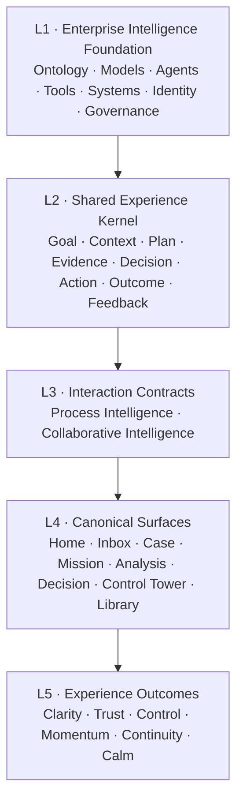

# Enterprise Intelligence Experience Principles 2.0

> Human–AI Work Experience Architecture  
> Canonical Concept Charter · Revision 0.3 · 2026-07-25

| 文档属性 | 内容 |
|---|---|
| 文档角色 | **Canonical**：Enterprise Intelligence Experience唯一架构源 |
| 状态 | Working Standard for Alignment & Reference Experience |
| 主要读者 | Product、UX、AI、Engineering、Data、Process、Security、Governance、PoC Delivery Partners |
| 战略输入 | Agentic AI Project 2027 Scope of Work Rev1.0 |
| 适用范围 | Process Intelligence、Collaborative Intelligence及二者之间的受控转换 |
| 非目标 | 单一产品PRD、品牌宣传册、生产组件包、具体技术架构或模型选型 |

## 文档套件与阅读路径

本Charter只负责冻结架构、语义边界、治理不变量和验收要求，不再同时承担管理层传播与组件说明。

| 文档 | 身份 | 回答的问题 |
|---|---|---|
| 本文件 | Canonical | Enterprise Intelligence由什么构成，哪些边界不可破坏 |
| [Experience Narrative](./EIX_2.0_EXPERIENCE_NARRATIVE.md) | Companion | 为什么这种体验值得建设，用户会感到什么不同 |
| [EIX Core Design System](./EIX_2.0_CORE_DESIGN_SYSTEM.md) | Candidate Standard | 通用界面如何通过Token、Primitive和Component一致构建 |
| [Intelligence UX Guidance](./EIX_2.0_INTELLIGENCE_UX_GUIDANCE.md) | Candidate Companion | Process Intelligence与Collaborative Intelligence如何把原则转成工作界面与状态 |
| [静态阅读站点](./index.html) | Interactive Reference | 如何检查架构、Design System、Guidance与Journey |

任何Companion、Prototype或Design System不得重新定义Kernel、Interaction Contract、语义轴或治理生命周期。发生冲突时，以本Charter为准。

---

## 0. 五分钟结论

### 0.1 一套Enterprise Experience，两种Interaction Contract

- **Process Intelligence**面向有状态、有规则、可编排的结构化工作。系统在明确权限和政策内推进，人处理授权、异常、边界和规则改进。
- **Collaborative Intelligence**面向目标驱动、上下文丰富、路径开放的知识工作。人拥有目标与最终判断，AI帮助理解、规划、分析、生成和准备行动。
- 两者共享Experience Kernel、Ontology、Identity、Permission、Evidence、Action、Outcome与Feedback，并采用不同的人机责任分配。

### 0.2 产品不以Chat为中心

Chat可以用于表达问题和修改工作，但企业成果必须形成稳定、可保存、可协作、可审计的Work Object与Artifact。

```text
Goal
  → Context
  → Plan
  → Evidence
  → Decision
  → Action
  → Outcome
  → Feedback
```

Canonical sequence：`Goal → Context → Plan → Evidence → Decision → Action → Outcome → Feedback`。

Prompt、对话、表单、拖拽、系统事件和Agent结果，只是在创建、修改或推进这些对象。

### 0.3 UI/UX是Human Control Layer

Ontology、Context、Policy、Permission、Agent Orchestration和Feedback Loop通常发生在后台。UI/UX的战略价值，是把这些隐藏能力转化为用户能够：

- 理解的工作；
- 校准的信任；
- 有效的控制；
- 可恢复的行动；
- 可复用的业务结果。

UI/UX是Human Control Layer，负责把数据语义、流程集成、治理和AI能力转成用户可理解、可控制、可恢复的业务操作。

---

## 1. Enterprise Intelligence Experience Architecture

### 1.1 五层体验架构



| 层级 | 回答的问题 | 典型Owner | 主要输出 | 明确边界 |
|---|---|---|---|---|
| Foundation | AI知道什么、能做什么、受什么约束 | Architecture、AI、Data、Process、Security | Ontology、Policy、Agent、Tool与系统能力 | 不定义用户工作方式 |
| Experience Kernel | 一份工作由哪些稳定对象构成 | Product、UX、Platform | Work Object Schema与共享行为 | 不等同于页面流程 |
| Interaction Contract | 人与AI在不同工作中如何分工 | Product、UX、Governance | 责任、状态、控制与反馈约定 | 不等同于产品或路由 |
| Canonical Surfaces | 用户在哪里完成任务 | Product、UX、Engineering | Case、Mission、Analysis等稳定工作面 | 不重新定义Kernel |
| Experience Outcomes | 用户是否真正理解并完成工作 | UX Research、Product、Business Owner | Clarity、Trust、Control等可衡量结果 | 不以视觉偏好代替任务结果 |

### 1.2 Shared Experience Kernel

#### Goal

用户或组织希望实现的业务结果。Goal使用业务语言表达，必须包含Success Definition、Owner、Scope和Constraints，不能等同于Prompt或技术任务。

#### Context

与当前工作相关且获得授权的信息，包括业务语义、用户与权限、流程状态、数据、文档、规则、历史决定和行动。

Context必须：

- 可查看、移除、纠正和追溯；
- 区分Session Context、Personal Memory、Team Memory与Enterprise Context；
- 记录Source、Freshness、Permission和适用Scope；
- 在跨Surface或跨Contract时保持连续但不过度扩散。

#### Plan

为实现Goal而形成的可检查路径。Plan包含节点、依赖、状态、风险、缺失输入、停止条件和可执行权限。

#### Evidence

支持Fact、Calculation、Claim、Decision或Recommendation的可验证依据。Evidence必须能够回到数据、文档、规则、事件或执行记录，而不是装饰性引用。

#### Decision

由Evidence与业务判断形成的明确选择，记录Option、Alternative、Rationale、Owner、Approval、Scope和使用的Evidence。

#### Action

改变外部状态的受控操作。Action必须声明Actor、Target、Scope、Parameters、Permission、Policy、Impact、Risk、Reversibility和Execution State。

#### Outcome

分析或Action实际产生的结果，包括Success、Partial、Failure、Exception和Pending。Outcome来自确定性系统记录，不由LLM重新发明。

#### Feedback

来自用户、业务结果、系统执行和评估的信号。Feedback必须区分：

- 对当前Work Object的修正；
- Context或Memory更新；
- Ontology或Rule Proposal；
- 模型、Agent或Pattern改进信号。

### 1.3 Kernel之外的共享控制机制

以下机制作用于Kernel对象，但不是第二套Kernel：

| 机制 | 作用 |
|---|---|
| Patch | 描述对Work Object的拟议变更，支持Diff、影响预览、确认和审计 |
| Gate | 对特定对象Revision执行确定性检查并产生可失效的Gate Decision |
| Receipt | 证明Evidence、Decision、Approval、Execution或Outcome发生了什么 |
| Revision | 对稳定对象产生不可变版本 |
| Branch | 隔离探索、追问或模拟，不污染Verified或Published状态 |
| Handoff | 在类型明确的Work Object之间传递Context、Evidence、Decision和控制约束 |

不得将`Intent → Patch → Execute → Gate`之类的交互顺序提升为Canonical Kernel。

---

## 2. Shared Work Object Model

### 2.1 Root Work Object与Typed Child Objects

一个Enterprise Goal使用Root Work Object保持身份和连续性；分析、决定、行动、流程Case和Artifact以类型明确的Child Object存在。

```ts
interface EnterpriseWorkRoot {
  rootId: string
  goal: Goal
  owner: Principal
  contextRefs: ContextRef[]
  childRefs: TypedWorkObjectRef[]
  permissions: PermissionPolicy
  traceId: string
  status: RootWorkStatus
}

type TypedWorkObject =
  | MissionObject
  | CaseObject
  | AnalysisObject
  | DecisionObject
  | ActionObject
  | ArtifactObject
  | RuleProposalObject

interface TypedWorkObjectBase {
  id: string
  rootId: string
  type: string
  revision: number
  parentRevision?: ObjectRevisionRef
  owner: Principal
  state: string
  contextSnapshot: ContextSnapshotRef
  evidenceRefs: EvidenceRef[]
  policyVersion: string
  permissionSnapshot: PermissionSnapshotRef
  traceId: string
  createdAt: string
  updatedAt: string
}
```

### 2.2 Revision、Branch与Trace

- Revision是不可变快照；修改已发布对象必须生成新Revision。
- Branch继承明确的Parent Revision，用于追问、模拟和探索。
- Trace ID用于跨对象关联，不代表这些对象共享同一状态机。
- Analysis、Process Case和Action不得通过切换页面模式在同一个可变对象上“变身”。
- Brief与Studio可以读取同一个Analysis Revision，但只改变信息密度，不改变事实。

### 2.3 Stable ID

ID使用类型化命名空间：

```text
ROOT-018
MIS-041
CASE-204
ANL-118
CLM-118
EVD-118
DEC-052
ACT-077
OUT-077
RPROP-204
```

Claim、Evidence、Action和Outcome不得复用同一个语义前缀。

---

## 3. Orthogonal Semantic Model

系统必须独立存储和表达以下七个轴。任一轴不得自动推出另一轴。

| Axis ID | 用户看到的语义 |
|---|---|
| `ClaimKind` | Claim Kind |
| `EvidenceStatus` | Evidence Status |
| `Uncertainty` | Uncertainty |
| `RiskAndReversibility` | Risk & Reversibility |
| `PermissionAndPolicy` | Permission & Policy |
| `Autonomy` | Autonomy |
| `WorkflowState` | Workflow State |

### 3.1 Claim Kind (`ClaimKind`)

| 值 | 含义 | 最低表达要求 |
|---|---|---|
| Fact | 可直接核实的事实 | Source、Scope、As-of |
| Calculation | 按确定性方法计算的结果 | Formula或Method、Inputs |
| Hypothesis | 待验证的候选解释 | 明确非事实、所需验证 |
| Forecast | 对未来的条件性判断 | Range、Assumptions、Horizon |
| Recommendation | 建议而非决定 | Rationale、Alternative、Owner |

### 3.2 Evidence Status (`EvidenceStatus`)

`Unverified → Supported → Verified`

旁路状态：`Contested`、`Stale`、`Insufficient`。

Evidence Status描述依据质量，不描述行动权限。

### 3.3 Uncertainty (`Uncertainty`)

只有在完成校准、定义适用对象、样本和决策用途后，才向用户展示Confidence或区间。裸小数不得作为可信度、风险和自动执行权限的共同表达。

### 3.4 Risk & Reversibility (`RiskAndReversibility`)

Risk至少考虑影响范围、敏感性、外部依赖和失败后果；Reversibility区分：

- Reversible；
- Compensatable；
- Irreversible。

### 3.5 Permission & Policy (`PermissionAndPolicy`)

Permission Decision包含：

- Subject；
- Object与Operation；
- Scope；
- Allowed / Conditional / Denied；
- Policy Version；
- Decision Time与Expiry。

### 3.6 Autonomy (`Autonomy`)

```text
Recommend
  → Prepare
  → Approval Required
  → Execute Within Policy
  → Monitor by Exception
```

Autonomy由Permission、Policy、Risk、Reversibility和系统能力共同约束。Evidence已Verified也不能绕过Permission或Policy。

### 3.7 Workflow State (`WorkflowState`)

Workflow State属于特定Work Object生命周期。颜色和文案不得把`Evidence Verified`、`Low Risk`、`Allowed`和`Executed`合成一个“绿色成功”状态。

---

## 4. Three Governed Lifecycles

### 4.1 Publication Lifecycle

```text
Draft
  → Validated
  → Approval Pending
  → Published
  → Superseded | Withdrawn
```

- Validated只表示发布检查通过，不代表已经Published。
- Published Revision不可被追问或编辑静默覆盖。
- Evidence、Scope、Policy或内容变化会使旧Gate Decision失效。

### 4.2 Action Lifecycle

```text
Proposed
  → Preflight Ready
  → Awaiting Approval
  → Approved
  → Queued
  → Executing
  → Succeeded | Partial | Failed
  → Compensated when required
```

- Approve不等于Execute。
- Execute前必须重新校验Subject、Permission、Policy、Evidence、Target State、Expiry和Idempotency。
- Undo只适用于仍可撤销的操作；已执行操作使用Rollback或Compensation，并产生新事件。

### 4.3 Rule Change Lifecycle

```text
Candidate
  → Drafted
  → Validated
  → Approved
  → Staged
  → Active
  → Suspended | Retired
```

单次人工判断只能产生Candidate。Rule Proposal至少需要：

- 明确Proposer与Rule Owner；
- 历史回放和反例测试；
- 冲突与覆盖范围分析；
- SoD Approval；
- Shadow、Staged或Canary验证；
- Monitoring、Kill Switch和Rollback；
- 仅影响未来符合Scope的Case。

---

## 5. Two Interaction Contracts

### 5.1 Process Intelligence Contract

> 系统在明确规则、权限和控制范围内推进结构化工作；人在关键决定、异常和边界场景中保持有效控制。

#### 工作特征

- 起点通常是业务事件、任务或状态变化；
- Case具有明确生命周期和Owner；
- 正常路径尽量安静地自动推进；
- 人的注意力优先用于异常、审批、抽检、恢复和边界改进；
- 每次Decision、Approval、Execution和Outcome分别留痕；
- Failure必须支持Retry、Rework、Compensation、Rollback或Takeover。

#### 基础生命周期

```text
Event
  → Interpret
  → Validate
  → Decide
  → Prepare
  → Approve when required
  → Execute
  → Verify Outcome
  → Close | Recover | Escalate
  → Capture Feedback
```

#### 默认分工

| 阶段 | 系统默认责任 | 人的默认责任 |
|---|---|---|
| Interpret | 识别对象、事件、状态和Context | 修正模糊或罕见情况 |
| Validate | 检查完整性、规则、权限和风险 | 处理Policy Exception |
| Decide | 执行确定性规则或形成候选判断 | 负责边界判断和授权 |
| Prepare | 构造Action Preview与Preflight | 检查影响和约束 |
| Execute | 在授权范围内执行并记录 | 不把Approve误认为已执行 |
| Verify | 核实真实Outcome和Postcondition | 处理业务偏差 |
| Recover | Retry、Compensate、Route、Pause | 接管无法自动恢复的Case |
| Improve | 汇总干预、异常和Outcome信号 | 确认Rule或Ontology Proposal |

#### 必须可见

Case Goal、State、Owner、Queue Age、Rule/Policy、Required Human Decision、Action Preview、Approval State、Execution State、Outcome、Exception、Recovery与Audit Timeline。

#### 不应该

- 用长对话代替Case状态；
- 只展示“自动处理比例”，隐藏Unknown、Failure、SLA和Recovery Debt；
- 要求人持续监督正常路径；
- 在无合法Policy时以低Confidence为由继续执行；
- 让审批者重新调查完整上下文；
- 把Agent拟人化为责任主体，掩盖Accountable Owner。

### 5.2 Collaborative Intelligence Contract

> 人定义Goal、Constraints和最终判断；AI帮助理解Context、规划工作、生成可验证Artifact，并在授权范围内准备或执行行动。

#### 工作特征

- 起点通常是问题、Goal、材料或需要完成的Artifact；
- 路径可以在工作中逐步形成；
- 多轮交互围绕同一Mission和Artifact积累；
- AI可以推荐下一步，但不能隐藏对Goal和Context的理解；
- Stable Artifact优先于Transcript；
- Insight可产生Action Proposal，但不直接改变外部状态。

#### 基础生命周期

```text
Frame Goal
  → Assemble Context
  → Propose Plan
  → Explore | Create | Analyze
  → Validate Evidence
  → Form Decision or Artifact
  → Publish or Propose Action
  → Review Outcome
  → Save, Reuse and Learn
```

#### 默认分工

| 阶段 | AI默认责任 | 人的默认责任 |
|---|---|---|
| Frame | 解释Goal、识别歧义和缺失输入 | 确认真实目的与边界 |
| Plan | 推荐路径、工具和Deliverable | 调整优先级与深度 |
| Work | 检索、分析、生成、比较和组织 | 提供业务判断和新Context |
| Validate | 绑定Evidence、暴露Limit与Conflict | 判断是否足以决策 |
| Decide | 组织Option、Trade-off和Impact | 作出或授权最终Decision |
| Publish | 准备Artifact Revision和Gate | 对发布负责 |
| Act | 形成Action Proposal与Preview | 授权高影响Action |
| Learn | 整理可复用Context和Feedback | 决定持久化边界 |

#### 必须可见

Mission Goal、Success Definition、Active Context、Intent、Plan、Artifact、Evidence、Limit、Next Best Action、Branch、Revision、Publication State和Action Handoff。

#### 不应该

- 把所有工作压缩成聊天记录；
- 在未说明Context和Scope时给出确定性建议；
- 用漂亮Narrative替代Evidence；
- 把Hypothesis写成Fact；
- 在追问时覆盖Verified或Published Revision；
- 以Confidence直接推导行动权限。

---

## 6. Controlled Cross-contract Handoff

### 6.1 Collaborative → Process

```text
Verified Evidence
  → Human-owned Decision
  → Action Proposal
  → Permission / Policy / Risk Preflight
  → Typed Process Case or Action Object
  → Approval when required
  → Execution
  → Outcome Receipt
```

### 6.2 Process → Collaborative

```text
Process Exception
  → Investigation Mission
  → Authorized Context Snapshot
  → Collaborative Analysis
  → Decision Record
  → Resume | Rework | Close Case
```

### 6.3 Handoff Envelope

```ts
interface HandoffEnvelope {
  handoffId: string
  rootId: string
  from: ObjectRevisionRef
  toType: "case" | "mission" | "analysis" | "action"
  goal: GoalRef
  scope: Scope
  contextSnapshot: ContextSnapshotRef
  evidenceRefs: EvidenceRef[]
  decisionOwner: Principal
  permissionSnapshot: PermissionSnapshotRef
  policyVersion: string
  actionConstraints?: ActionConstraints
  requestedDecision?: string
  traceId: string
}
```

Handoff创建关联对象，不允许一个Document或Case在客户端静默更换语义类型。

---

## 7. Collaborative Intelligence Families

### 7.1 五类知识工作

| Family | 核心问题 | 典型Artifact |
|---|---|---|
| Knowledge & Research | 我们知道什么，依据与冲突是什么 | Answer with Sources、Research Board、Evidence Map |
| Analytical | 发生了什么、为什么、接下来可能怎样 | Verified Answer、Analysis Document、Scenario Canvas |
| Decision | 面对Option应如何形成可解释选择 | Decision Canvas、Option Matrix、Decision Record |
| Creation & Communication | 如何形成可协作、可发布的业务产出 | Document、Deck、Message、Structured Output |
| Planning & Action | 如何把Goal变成计划并安全推进 | Execution Plan、Planning Board、Action Queue |

AI自助分析属于Analytical Intelligence，不能代表全部Collaborative Intelligence。

### 7.2 Analytical Intelligence五维坐标

分析体验不再以互斥的“七种产品模式”分类，而由五个维度组合：

| 维度 | 候选值 |
|---|---|
| Work Question | Rapid Answer、Explore、Compare、Monitor、Diagnose、Investigate、Forecast、Simulate、Decide |
| Initiation | User Pull、Scheduled、Event-triggered、Delegated Goal |
| Control Posture | Direct、Guided、Co-created、Delegated |
| Surface / Artifact | Answer、Workspace、Board、Canvas、Brief、Feed |
| Action Authority | Read、Recommend、Prepare、Approval Required、Execute Within Policy |

例如“CFO Morning Brief”可以是`Monitor × Scheduled × Guided × Brief × Recommend`；“委派式利润诊断”可以是`Diagnose × Delegated Goal × Delegated × Analysis Document × Prepare`。

---

## 8. Human–AI Design Principles

每条原则使用同一结构：用户焦虑、机制、体验承诺与Design Test。

### Principle 01 — Work Object before Chat

- **用户焦虑：** 我必须翻聊天记录才能知道现在做到哪里。
- **机制：** 先定义Goal、Owner、State、Scope和Artifact，再提供Chat作为输入与变更通道。
- **体验承诺：** 我不读Transcript也能继续工作。
- **Design Test：** 用户能否在十秒内说出当前工作对象、目标、状态和输出？

### Principle 02 — One Context, Explicitly Scoped

- **用户焦虑：** 我不知道AI用了什么信息，也不知道信息会不会被长期记住。
- **机制：** Context Inspector显示Source、Freshness、Permission、Memory边界和Remove/Correct。
- **体验承诺：** 我知道AI正在依据什么，并能纠正它。
- **Design Test：** 用户能否区分Session、Personal、Team和Enterprise Context？

### Principle 03 — Intent and State Must Be Visible

- **用户焦虑：** AI可能理解错了，但直到结果出来我才发现。
- **机制：** Goal Interpretation、Intent Ribbon、Patch Diff和稳定State常驻可见。
- **体验承诺：** 系统不会背着我改变问题。
- **Design Test：** Scope或Method变化是否明确显示影响并重新验证？

### Principle 04 — Autonomy Must Be Progressive

- **用户焦虑：** AI会不会把“建议”直接变成“执行”。
- **机制：** Recommend、Prepare、Approve和Execute分级，并由Permission、Policy、Risk和Reversibility共同约束。
- **体验承诺：** 自主权增长可见、可解释、可停止。
- **Design Test：** 高Confidence但Denied的Action是否仍被阻断？

### Principle 05 — Evidence before Eloquence

- **用户焦虑：** 一个写得漂亮的结论可能没有可靠依据。
- **机制：** Claim绑定Typed Evidence Receipt；Narrative数字引用同一Result Object。
- **体验承诺：** 我能从结论回到来源、方法和限制。
- **Design Test：** Stale、Insufficient或Contested Evidence是否阻止Verified表达？

### Principle 06 — Human Intervention Is Designed

- **用户焦虑：** 系统失败后，我必须从头调查。
- **机制：** Handoff携带Context Pack、Work Done、Evidence、Failure Reason和Requested Decision。
- **体验承诺：** 接管是连续工作，不是重新开始。
- **Design Test：** 人工接管是否保留已完成且已验证的工作？

### Principle 07 — Preview Consequence before Action

- **用户焦虑：** 我不知道点击按钮究竟会改变什么。
- **机制：** Action Preview显示Actor、Target、Parameters、Impact、Permission、Risk和Reversibility。
- **体验承诺：** 改变现实之前，我先看见后果。
- **Design Test：** 用户能否区分Prepare、Approve、Queue和Execute？

### Principle 08 — Reversible by Default

- **用户焦虑：** 一次错误操作可能无法恢复。
- **机制：** 为Action定义Undo、Rollback、Compensation或Takeover，并显示有效窗口。
- **体验承诺：** 出错后仍然有路可走。
- **Design Test：** 不可逆Action是否具有额外Gate和Owner确认？

### Principle 09 — Preserve Verified State

- **用户焦虑：** 新追问或高级分析失败会破坏已经确认的内容。
- **机制：** Verified/Published Revision不可变；追问创建Branch，高阶失败只标记Partial。
- **体验承诺：** 探索不会污染正式结论。
- **Design Test：** Attribution失败时基础KPI是否仍保持Verified？

### Principle 10 — Stable Artifacts over Transcripts

- **用户焦虑：** 一段回答无法被复用、协作和审计。
- **机制：** 产出形成有Owner、Revision、Evidence和History的Artifact。
- **体验承诺：** 工作成果能脱离对话独立存在。
- **Design Test：** Artifact是否可以被引用、发布、比较和继续编辑？

### Principle 11 — Role-adaptive Density, Shared Truth

- **用户焦虑：** 简化页面可能隐藏风险，不同角色可能看到不同事实。
- **机制：** Brief与Deep Dive读取同一Revision，只改变信息密度。
- **体验承诺：** 我看到适合我的深度，但事实不变。
- **Design Test：** Brief是否仍保留Scope、Freshness、Risk和Limit？

### Principle 12 — Failure Must Preserve Orientation

- **用户焦虑：** “发生错误”没有告诉我还能相信什么、下一步做什么。
- **机制：** Degradation固定回答：哪里失败、为什么、什么仍有效、缺什么、下一步。
- **体验承诺：** 失败不会让我失去方向。
- **Design Test：** Partial状态是否明确保留Verified部分并提供可执行下一步？

### Principle 13 — Visual Language Carries Semantics

- **用户焦虑：** 所有状态都用红黄绿，导致“可信”“允许”和“成功”混为一谈。
- **机制：** Claim、Evidence、Risk、Permission、Autonomy和Workflow使用独立标签、文字、符号与结构。
- **体验承诺：** 我不会因为颜色相同而误读治理状态。
- **Design Test：** 去掉颜色后，各语义轴是否仍可区分？

### Principle 14 — Feedback Must Improve Transparently

- **用户焦虑：** 我的纠正可能被系统永久学习，或一次判断直接变成规则。
- **机制：** 区分单次Correction、Memory Proposal、Rule Proposal和Model Feedback，并显示Owner与审批路径。
- **体验承诺：** 我知道反馈去了哪里、将改变什么。
- **Design Test：** 单次人工判断是否只能产生Candidate而不能直接Active？

---

## 9. Canonical Experience Patterns

Charter只冻结Pattern目录和不变量；领域Anatomy、States、Variants和交互示例见[Intelligence UX Guidance](./EIX_2.0_INTELLIGENCE_UX_GUIDANCE.md)。通用视觉与组件契约见[EIX Core Design System](./EIX_2.0_CORE_DESIGN_SYSTEM.md)。

### 9.1 Shared Patterns

- Goal & Context Header
- Intent / Change Preview
- Plan & Progress
- Evidence Receipt
- Decision Record
- Publication Gate
- Action Preview & Authorization
- Outcome Receipt
- Branch & Revision
- Human Handoff
- Feedback Capture
- Degradation & Partial Result

### 9.2 Process Patterns

- Work Queue
- Case Workspace
- Decision Checkpoint
- Approval Brief
- Exception-first Console
- Rule Proposal & Change Approval
- Recovery & Rollback
- Process Control Tower
- Execution Audit Timeline

### 9.3 Collaborative Patterns

- Mission Workspace
- Research Board
- Analysis Document
- Decision Canvas
- Creation Workspace
- Planning Board
- Audience Brief
- Artifact History & Branch
- Personal / Team Memory Library

### 9.4 Pattern不变量

每个Pattern必须声明：

- User Goal与User Fear；
- Work Object、Owner和Applicable Contract；
- Fixed与Optional Regions；
- 语义轴和Lifecycle；
- Permission、Autonomy与Gate；
- Failure、Degradation、Recovery与Takeover；
- Responsive与Accessibility；
- Acceptance Tests。

只有在两个实质不同的产品或Contract中验证出共同形状后，Pattern才能晋升为共享工程组件。

---

## 10. Semantic Visual Language

### 10.1 Token层级

```text
foundation.*   品牌、字体、空间、表面与基础边框
interaction.*  选择、焦点、变化与可操作性
claim.*        Fact、Calculation、Hypothesis、Forecast、Recommendation
validation.*   Unverified、Supported、Verified、Contested、Stale、Insufficient
risk.*         Impact与Reversibility
permission.*   Allowed、Conditional、Denied
workflow.*     Draft、Pending、Approved、Executing、Succeeded、Failed等对象状态
```

不同Token Namespace可以复用色相，但组件必须同时显示轴名称、文字、符号和必要的结构差异。

### 10.2 Visual Character

- 精准而非炫技；
- 安静而非冷漠；
- 高密度但有清晰层级；
- 像工作底稿而不是AI宣传页；
- 视觉变化必须对应真实状态变化；
- 关键数字使用Tabular Numerals；
- Query、Trace和ID使用等宽字体。

渐变、圆角、插画或Emoji不是架构禁令；是否使用由品牌、语义、可读性和场景决定。不可协商的是：不得用装饰制造虚假智能感，不得牺牲证据和控制。

### 10.3 Motion

动效只用于解释Patch变化、Plan推进、Block生成、Revision/Branch和真实Workflow State变化。Reduced Motion下必须保留全部信息。

### 10.4 Responsive Capability

- ≥1280：完整多面板、Pattern Inspector和复杂直接操作；
- 768–1279：单主栏，Inspector转Drawer；
- <768：Brief阅读、Journey、评论与审批，不提供复杂拖拽；
- 所有密度读取同一Work Object Revision。

---

## 11. Gate与Receipt不变量

### 11.1 Gate Decision

Gate必须绑定：

- Gate Type；
- Subject ID与Revision；
- Evidence Snapshot；
- Policy与Permission Version；
- Actor与Decision Time；
- Checks、Pass / Fail / N/A；
- Expiry与Invalidation Reason。

任何Scope、Evidence、Policy、Permission、Target State或内容变化都会使旧Gate Decision失效。提交或执行时必须原子重验。

### 11.2 Typed Receipts

| Receipt | 证明什么 |
|---|---|
| Evidence Receipt | 来源、语义版本、方法、Scope、Freshness、权限裁剪和限制 |
| Decision Record | 谁基于什么Evidence选择了什么 |
| Approval Receipt | 谁在何种Policy与Scope下授权 |
| Execution Receipt | 请求、执行、目标、参数、时间、状态、部分失败和Idempotency |
| Outcome Receipt | Postcondition、业务结果、差异、Exception和Next State |
| Rule Change Receipt | Candidate、验证、SoD、版本、Stage、Monitor与Rollback |

视觉Frame可以共享，Schema和Lifecycle必须类型化。

---

## 12. Enterprise Intelligence UX Acceptance

### 12.1 Orientation

- 用户能识别Goal、Work Object、State、Owner和Revision；
- 无需阅读History即可解释当前发生了什么；
- 跨Contract时知道创建了哪个新对象及其来源。

### 12.2 Comprehension

- 用户能解释Intent、Plan、主要Limit和下一步；
- 能区分Claim Kind、Evidence Status、Risk、Permission、Autonomy和Workflow State；
- 能区分Prepared、Approved、Queued、Executed和Outcome。

### 12.3 Control

- 写入前具有Preview、Permission、Policy、Impact和Reversibility；
- Pause、Cancel、Takeover、Rollback或Compensation在适用时可用；
- Gate失效不会静默复用旧批准。

### 12.4 Trust Calibration

- Claim可回到Typed Evidence；
- 未校准Confidence不制造虚假精确感；
- Stale、Insufficient或Contested Evidence不会呈现为Verified。

### 12.5 Task Outcome

- 用户完成Goal，而不仅获得回答；
- Artifact可保存、共享、比较、复用和审计；
- Outcome来自真实系统记录。

### 12.6 Recovery

- Failure、Partial和Exception说明原因、保留项、缺失项和下一步；
- 高阶能力失败不删除Verified基础工作；
- Takeover保留Context和Work Done。

### 12.7 Continuity

- History、Branch、Revision和Handoff可继续工作；
- Context和Memory更新边界明确；
- 不同Surface读取同一事实Revision。

### 12.8 Accessibility

- 完整键盘路径；
- 状态不只依赖颜色；
- 动态变化可被辅助技术感知；
- 支持Reduced Motion；
- 图表和Evidence具备等价文本；
- 正文达到WCAG 2.2 AA；
- 触控目标满足最小尺寸要求。

### 12.9 Reader & Experience Evaluation

| 维度 | Rev 0.3 Reference目标 |
|---|---|
| Architecture comprehension | ≥90%读者能解释一个Kernel与两种Contract |
| Semantic comprehension | ≥85%能区分Evidence、Risk、Permission和Autonomy |
| State comprehension | ≥95%能区分Prepared、Approved、Executed与Outcome |
| Pattern selection | ≥85%能为给定场景选择适用Pattern |
| Document identity | 100%知道Canonical、Companion与Candidate的区别 |
| Operational correctness | 非法状态迁移、越权Action和状态矛盾为0 |

正式业务指标仍需基于真实场景建立基线，不在Charter中虚构ROI。

---

## 13. Proposed UX Workstream for 2027

建议在SOW中建立独立横向工作流：

> Enterprise Intelligence Experience Architecture & Design

### 13.1 Scope

- 维护Canonical Charter与Shared Kernel；
- 定义两种Interaction Contract和受控Handoff；
- 建立Experience Narrative与Reference Journey；
- 建立Core Design System与Intelligence UX Guidance；
- 定义Human Oversight、Gate、Action和Recovery；
- 设计Reference Prototypes；
- 建立Reader Testing、UX Evaluation和Acceptance方法；
- 与Ontology、AI、Process、Security和Front-end共同交付。

### 13.2 Deliverables

1. Canonical Concept Charter；
2. Experience Narrative；
3. EIX Core Design System；
4. Intelligence UX Guidance；
5. End-to-end Experience Architecture Map；
6. Cross-contract Handoff Specification；
7. Semantic Visual Language与Token候选规范；
8. Reference Journey与Prototype Set；
9. UX Research、Reader Testing与Acceptance Kit；
10. Accessibility、Human Oversight与Design-to-Engineering Handover Standard。

### 13.3 工程化触发条件

只有满足以下条件才建设共享生产组件包：

- 至少两个实质不同的真实消费者；
- 三套Lifecycle和七个语义轴稳定；
- 共同Pattern中不含领域名称和场景分支；
- Component API、Version、Migration和Owner明确；
- Accessibility和状态测试自动化。

---

## 14. Decisions Locked by Revision 0.3

1. 只有一个Canonical Shared Experience Kernel。
2. Process Intelligence与Collaborative Intelligence是两种Interaction Contract，不是两个孤立产品。
3. Patch、Gate、Receipt、Revision和Handoff是机制，不是第二Kernel。
4. Chat是输入与控制通道，不是默认产品架构。
5. Root Work Object与Typed Child Objects保持连续性，Analysis、Case和Action不共享可变状态机。
6. Publication、Action和Rule Change使用三套独立Lifecycle。
7. Claim、Evidence、Uncertainty、Risk、Permission、Autonomy和Workflow State正交。
8. Approve不等于Execute；Verified不等于Allowed或Auto。
9. 单次人工判断只能产生Rule Candidate。
10. Gate绑定Revision、Evidence、Policy和Permission，并在提交时重验。
11. AI自助分析属于Analytical Intelligence，不代表全部Collaborative Intelligence。
12. Stable Artifact优先于Transcript。
13. Human Oversight、Evidence、Recovery和Audit是体验结构。
14. Visual Language表达语义和控制权，不以风格偏好替代治理。
15. Companion和Prototype不拥有架构主权。
16. UI/UX是2027 SOW的独立横向工作流和验收维度。
17. Core Design System与Intelligence UX Guidance分层；Core Component不拥有业务Lifecycle。
18. Neutral Core与EIX Theme共享Semantic Contract，Theme不改变业务语义。

---

## 15. Open Questions

以下问题不阻止Rev 0.3成立，但需要Owner和决策时间：

1. Personal、Team和Enterprise Memory的权限与可见边界；
2. Autonomy Policy由谁配置，是否按Role、Scenario、Risk和Region变化；
3. Root与Child Work Object采用统一ID服务还是可追溯映射；
4. 哪些Feedback可自动进入改进管道，哪些必须由Ontology或Rule Owner审批；
5. Agent活动默认显示到Task、Step还是Tool Call层级；
6. 管理层、业务用户、专家和运营人员的默认信息密度；
7. 哪两个真实产品将作为共享Pattern工程化的第二消费者；
8. 哪两个真实产品将触发`@eix/tokens`与`@eix/ui`生产组件包阶段。

---

## Appendix A — Working Glossary

| Term | Working Definition |
|---|---|
| Enterprise Intelligence Experience | 企业用户理解、控制并与AI共同完成工作的整体体验 |
| Interaction Contract | 人与系统在一种工作模式中的责任、状态、控制和反馈约定 |
| Experience Kernel | 所有场景共享的稳定体验对象 |
| Root Work Object | 维持Goal、Owner、Context和Trace连续性的根对象 |
| Typed Child Object | Analysis、Case、Decision、Action等具有独立Lifecycle的对象 |
| Artifact | 能脱离对话独立使用、版本化和审计的稳定产出 |
| Patch | 对Work Object拟议修改的可预览、可确认、可审计对象 |
| Gate Decision | 针对特定Revision和治理快照的确定性校验结果 |
| Evidence Receipt | 将Claim连接到Source、Method、Scope、Freshness和Limit的对象 |
| Action Preview | 在改变外部状态前展示Actor、Target、Impact、Permission和Reversibility |
| Handoff | 在Typed Work Objects之间传递授权Context和控制约束 |
| Branch | 不覆盖Parent Revision的探索或追问分支 |
| Semantic Visual Language | 使用视觉结构表达正交业务语义和控制权的规则 |

## Appendix B — Canonical Review Checklist

- [ ] 文档是否明确Canonical、Companion与Candidate身份；
- [ ] 是否只有一个Shared Experience Kernel；
- [ ] Work Object是否类型明确且Lifecycle独立；
- [ ] 两种Interaction Contract责任边界是否清晰；
- [ ] Cross-contract Handoff是否携带完整治理Envelope；
- [ ] 七个语义轴是否独立存储和表达；
- [ ] Publication、Action和Rule Change是否使用独立Lifecycle；
- [ ] Gate是否绑定Revision并可被变化失效；
- [ ] Approve、Execute、Outcome是否可被用户区分；
- [ ] Principles是否同时包含User Fear、Mechanism、Promise和Design Test；
- [ ] Pattern是否定义Failure、Recovery和Accessibility；
- [ ] Visual Language是否表达语义而非AI装饰；
- [ ] Acceptance是否可进入PoC和SOW；
- [ ] Open Question是否有Owner与决策时点；
- [ ] 是否避免将UI/UX缩减为Front-end Delivery。
